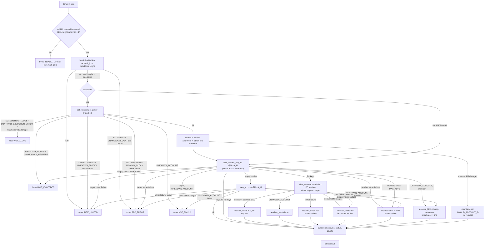

# GĐ1 design: `scanAccount`, `scanDao`, rules, RPC client

Scope: `docs/final-idea.md:874` (GĐ1: `rpc.ts`, `scanAccount`, `scanDao`, the §5.1 rules, `messages`). Contracts: `packages/key-doctor/src/types.ts` (unchanged; `Flag.rule_id` stays `string`, `types.ts:51`; `ScanOptions` unchanged, `types.ts:297-305`). Done-when (owner, 2026-10-29, replaces "scan the 20 prototype accounts"): a fixture corpus with one positive and one negative case per rule, plus the owner's live testnet run (section 11). GĐ1 is **built** when S1-S4 pass and **done** only after the owner records that run. Lane: high-risk (`rpc.ts` is in `.claude/dev-team.md` `high_risk`).

## 1. Flow

The section 3 tables win over this diagram on any conflict.

## 2. Modules (all new under `packages/key-doctor/src/` unless a path is given)

| File | Owns |
|---|---|
| `rpc.ts` | `DEFAULT_RPC_URL = {mainnet, testnet}` (one constant). `createRpc({ url, fetchImpl? })`, the only `fetch` caller. Default fetch `(...a) => globalThis.fetch(...a)`, resolved at call time (a stored `fetch` called as a method throws "Illegal invocation" in browsers). Methods `block`, `viewAccessKeyList`, `viewAccount`, `callFunction`. Maps errors to `KdErrorException`. |
| `errors.ts` | `KdErrorException` (extends `Error`, field `kd: KdError`; never sets `cause`), `isKdError`, fixed vi/en text per code (`final-idea.md:503-518`). |
| `parse.ts` | `resolveTarget(id, opts) → {id, network, kind}` (section 8), account kind, raw key to `KeyInfo`, raw policy to roles. |
| `age.ts` | Nonce split and age estimate (section 5). |
| `messages.ts` | One `(evidence) => Messages` per rule id, plus vi/en text per member error code. |
| `rules/thresholds.ts` | `RULESET_VERSION = "2026-11-01"`, `RULE_ORDER` (the 13 ids in §5.1 order), and every number in sections 5, 6 and 9. |
| `rules/key.ts`, `rules/account.ts`, `rules/dao.ts`, `rules/index.ts` | Pure rule functions; `index.ts` runs them in `RULE_ORDER`. |
| `scan.ts` | `scanAccount`, `scanDao`, the hand-written pool, the request budget, summary, and the pure `buildMember(input) → Member`. Every member goes through it, so GĐ7 can add an optional `ScanOptions` field later. No per-member callback in GĐ1. |
| `index.ts` | Adds value exports beside today's `export type * from "./types.ts"` (`index.ts:3`). |
| `packages/key-doctor/scripts/scan.ts` | Live-run entry point, section 11. `packages/key-doctor/tsconfig.json` adds `scripts` to `include`, so the package typecheck covers it (the root typecheck runs only `packages/*` workspaces). |

The package imports no `node:*` module, and only `rpc.ts` calls `fetch`.

## 3. RPC calls and their error paths

Requests are `POST` to one URL with body `{jsonrpc:"2.0", id:"kd", method, params}`. The URL is `opts.rpcUrl`, else `DEFAULT_RPC_URL[network]` (`https://rpc.testnet.near.org`, `https://rpc.mainnet.near.org`). The first call is `block`. Every later call, including `get_policy` and receiver checks, carries `block_id: <head height>` (`final-idea.md:564`, `usecase.md:144`). No retries. Each request has a 15 s `AbortController` timer that stays armed until the body is parsed, so a stalled body read also times out.

| Signal (all calls) | `get_policy` | Other calls |
|---|---|---|
| HTTP 429 | `RATE_LIMITED`, retryable | same |
| HTTP 5xx, abort, network failure, non-JSON body, neither `result` nor `error` | `RPC_ERROR`, retryable | same |
| cause `UNKNOWN_BLOCK` | `RPC_ERROR`, retryable; not retryable when `opts.blockHeight` was given | same |
| cause `UNKNOWN_ACCOUNT` | `NOT_FOUND` | `NOT_FOUND` |
| cause `NO_CONTRACT_CODE` or `CONTRACT_EXECUTION_ERROR` | `NOT_A_DAO` | `RPC_ERROR`, not retryable |
| any other cause (e.g. `GARBAGE_COLLECTED_BLOCK` for an old `opts.blockHeight`) | `RPC_ERROR`, not retryable | same |
| `result.error` string, or bytes that do not decode to JSON with a `roles` array | `NOT_A_DAO` | n/a |

The cause names are recalled from the NEAR RPC docs (checklist, section 11).

| Call | Failure | Report | `errors[]` | `members[].error` | `limitations` |
|---|---|---|---|---|---|
| `block`, `get_policy` | any | none, throws the mapped `KdError` | | | |
| `view_access_key_list`, scanAccount target | any | none, throws (a one-member report with no data is not useful) | | | |
| `view_access_key_list`, DAO member | `UNKNOWN_ACCOUNT` | as a missing member (next rows) | none | null | the missing-member line |
| same | other, or over `MAX_KEYS` | yes, `keys: []`, `flags: []` | `member <id>: <CODE>` | `RATE_LIMITED` / `RPC_ERROR` / `LIMIT_EXCEEDED` | none |
| `view_account` after an empty list | `UNKNOWN_ACCOUNT` | target throws `NOT_FOUND`. Member: `account_kind: "missing"`, `error: null`, no flags, status `note` | none | null | `Council member <id> does not exist; anyone who creates it gains its vote.` |
| same | other | target throws. Member: as a failed key list | `member <id>: <CODE>` | `<CODE>` | none |
| same | ok | `keys: []`, account exists with no keys | none | null | none |
| `view_account`, FC receiver | `UNKNOWN_ACCOUNT` | `receiver_exists: false` on every FC key with that receiver | none | null | none |
| same | other | `receiver_exists: null` | `receiver <id>: <CODE>` | null | none |
| same | not sent (`skipReceiverCheck`, budget, or id fails regex) | `receiver_exists: null` | none | null | `Some function-call key receivers were not checked.` (once) |

- The follow-up exists because a missing account may give `keys: []` instead of `UNKNOWN_ACCOUNT`.
- A receiver equal to the scanned DAO gets `receiver_exists: true` with no request.
- `receiver_exists` is set only on FC keys. FA keys have no such field (`account-b.report.json:41-55`).
- `errors[]` and `members[].error` hold only a code from the closed set plus a validated account id, never RPC text. `errors[]` order: member lines in final `members[]` order, then receiver lines by receiver id (code-unit order).

## 4. Council, vote policy, DAO block

Sputnik v2 facts, recalled from `sputnikdao2/src/policy.rs`, unchecked (section 11).
- A permission matches `kind:action` when the role lists `kind:action`, `kind:*`, `*:action` or `*:*` (`Policy::can_execute_action`).
- The vote policy for a role and kind is `role.vote_policy[label]`, else `default_vote_policy`.
- `WeightOrRatio::to_weight(total)`: `Weight(w)` → `min(w, total)`. `Ratio(n, d)` → `min(floor(n*total/d) + 1, total)`. The pass threshold is `max(quorum, to_weight)`.

`approvals_needed(role, label)` returns that number only when the role kind is `Group` and `weight_kind` is `RoleWeight` (`total` = group size), else `null`. Check: `[1,2]` on 3 members gives 2 (`fixtures/reports/dao-kd-demo.report.json:41`).

| Output | Rule |
|---|---|
| `dao.roles` | Every policy role in policy order. Kind lowercased (`Everyone` → `everyone`, `{Group}` → `group`, `{Member}` → `member`). `members` is the group list, else `[]`. `can_approve_transfer` = role matches `transfer:VoteApprove`. |
| `dao.transfer_vote_policy` | One entry per role with `can_approve_transfer`: `{role, weight_kind, threshold (verbatim), approvals_needed}`. |
| `dao.proposal_bond_yocto` | `policy.proposal_bond`, as a string. |
| Admin labels | `policy`, `policy_add_or_update_role`, `policy_remove_role`, `policy_update_default_vote_policy`, `policy_update_parameters`. |
| Admin role | Matches `L:VoteApprove` for some admin label `L`, with `approvals_needed(role, L) === 1` (owner decision 3). |
| Council | Distinct union of `Group` members of transfer-approving roles and of admin roles. `council_size` is its size. `Member.roles` lists the role names that hold the member, in policy order. |

Limitation lines (fixed text, once per role):

| Condition | Line |
|---|---|
| Non-`Group` role that can approve transfers | `Role <name> lets non-listed accounts approve transfers; they are not scanned.` |
| Non-`Group` role that matches `L:VoteApprove` for an admin label | `Role <name> lets non-listed accounts approve policy changes; they are not scanned.` |
| `Group` role with `weight_kind` `TokenWeight` that can approve transfers or an admin label | `Role <name> votes by token weight; its approvals needed and admin status are not computed.` |

## 5. Key parsing and age

- Curve from the key prefix: `ed25519:` → `ed25519`, `mldsa65:` → `ml_dsa`, else `unknown`. The ML-DSA prefix is a placeholder (`fixtures/README.md:14`; checklist).
- `"FullAccess"` → `{type:"full_access"}`. `{FunctionCall:{allowance, receiver_id, method_names}}` → `function_call` with `allowance_yocto = allowance` (null stays null).
- `nonce` is kept as `String(n)`, split with `BigInt`: `h = nonce / 10^6`, `uses = nonce % 10^6` (`final-idea.md:564`). Nonces near 1.8e14 < 2^53 stay exact in `JSON.parse`.
- `thresholds.ts`: `BLOCK_TIME_MS = 1200` (owner decision 4, `fixtures/README.md:16`); `GENESIS_HEIGHT = { mainnet: 9820210, testnet: 42376888 }` (recalled; checklist).
- Known age when `GENESIS_HEIGHT[network] <= h <= head`: `source: "nonce_estimate"`, `block_height: h`, `at = block_timestamp - (head - h) * BLOCK_TIME_MS` floored to whole seconds, `age_days = floor((head - h) * BLOCK_TIME_MS / 86_400_000)`, `use_count = uses`.
- Unknown age when `h < GENESIS_HEIGHT[network]` or `h > head`. (Pre-mid-2021 keys hold a small counter, `final-idea.md:564`.) Result: `source: "unknown"`, `block_height: null`, `at: null`, `age_days: null`; `use_count = uses` when `h === 0`, else `null`.
- Times are ISO 8601 UTC with whole seconds (`2026-07-24T03:17:56Z`). `block_timestamp` comes from `header.timestamp_nanosec`.
- The limitation `Key age is estimated from the access-key nonce, assuming 1.2 s blocks.` is always present. This changes the text in `dao-kd-demo.report.json:420` (S3) and `account-b.report.json:153` (S1).

## 6. Rules (`final-idea.md:523-539`)

"FA" means full-access. `n_ed` = number of Ed25519 FA keys, `n_ml` = number of ML-DSA keys. Every threshold lives in `thresholds.ts`.

| Rule | Fires when | Scope, key `flag_ids` |
|---|---|---|
| `FA_MANY` high | `n_ed >= FA_MANY_MIN (5)` | account; on each Ed25519 FA key |
| `DAO_ADMIN` high | member of an admin role (section 4), scanDao only | dao, `account_id` set; in `member.flags`; no key ids |
| `FC_DAO_VOTE` high | council member's FC key with `receiver_id === daoId` and (`method_names` empty or contains `act_proposal`), scanDao only | key |
| `FA_MULTIPLE` cleanup | `FA_MULTIPLE_MIN (2) <= n_ed` and `FA_MANY` did not fire | account; on each Ed25519 FA key |
| `PQ_PARTIAL` cleanup | `n_ml >= 1` and `n_ed >= 1` | account; on each Ed25519 FA key |
| `FA_OLD` cleanup | FA key with `age_days > FA_OLD_DAYS (730)` or `created.source === "unknown"` | key |
| `KEY_UNUSED` cleanup | any key kind with `use_count === 0` | key |
| `FC_UNLIMITED_ALLOWANCE` cleanup | FC key with `allowance_yocto === null` | key |
| `FC_ANY_METHOD` cleanup | FC key with `method_names` empty | key |
| `FC_DEAD_RECEIVER` cleanup | `receiver_exists === false` (missing account only) | key |
| `FA_BOT_LIKE` cleanup | FA key with `use_count >= FA_BOT_LIKE_USES (1000)` | key |
| `PQ_NONE` note | `keys.length >= 1` and `n_ml === 0` | account; no key ids (`dao-kd-demo.report.json:88-163`) |
| `COUNCIL_SMALL` note | `1 <= council_size <= COUNCIL_SMALL_MAX (2)` | dao, in `dao_flags` |

- A missing council member (section 3) gets status `note` and no flag. The 13 rules stay frozen (owner, 2026-10-29).
- `DAO_ADMIN` sits in `member.flags`, so the member's status rises to high. The dashboard "DAO flags" section shows `dao_flags` plus every member flag with `scope: "dao"`.
- Order: `member.flags` by severity (high, cleanup, note), then `RULE_ORDER`, then key order. Key `flag_ids` follow `RULE_ORDER`. Keys keep RPC order. This matches `dao-kd-demo.report.json:88-163, 305-307`.
- Each flag's `evidence` holds only the numbers its message uses, e.g. `{full_access_ed25519: 5}` (`dao-kd-demo.report.json:173-175`). `messages.ts` builds vi and en text from `evidence` only, never from RPC text.

Error and member-error text (vi + en, fixed per code):

| Code | en meaning |
|---|---|
| member `RPC_ERROR`, `RATE_LIMITED`, `INVALID_ACCOUNT_ID` | "Could not read this account's keys. Its risk is unknown, not low." |
| `LIMIT_EXCEEDED` (council) | "This DAO has more than 21 council members; Key Doctor scans at most 21." |
| `LIMIT_EXCEEDED` (roles / keys) | names `MAX_ROLES` / `MAX_KEYS` the same way |
| other `kd.error.v1` codes | `final-idea.md:503-518`; no text implies low risk |

Cap numbers in messages come from `thresholds.ts`.

## 7. Status, summary, counts, sort

| Field | Rule |
|---|---|
| `member.status` | Highest severity in `member.flags`, else `ok`. `error !== null` → `note`. Missing account → `note`. Only note flags → `note`. |
| `member.counts` | `full_access`: FA keys of any curve. `function_call`: FC keys. `ml_dsa`: keys with curve `ml_dsa`, any permission. `unused`: `use_count === 0`. `pq_ready = n_ml >= 1 && n_ed === 0`. |
| `summary.status` | Highest of all `member.status` and all `dao_flags` severities, else `ok`: the DAO's level is its weakest member's level (`usecase.md:148`). |
| `council_size` | Section 4 size. An account target gives `0` (`account-b.report.json:16`). |
| `members_scanned` | Members with `error === null` (includes missing accounts), so a UI can say "2 of 3 read". |
| `members_high`, `members_cleanup` | `error === null` and that status. |
| `members_ok` | `error === null` and status `ok` or `note`. So `members_high + members_cleanup + members_ok = members_scanned` (`final-idea.md:311`). An errored member is in none of the four. |
| `pq_ready`, `keys_total`, `keys_full_access`, `keys_unused` | Sums over `error === null` members (`dao-kd-demo.report.json:46-57`: 1, 8, 7, 2). |
| All members errored | `members_scanned: 0`, all counts 0, `summary.status: "note"`. |
| Member sort | `error === null` first, ordered high, cleanup, note, ok; then errored members; ties by `account_id` in code-unit order. |
| Determinism | Same block and same RPC answers → identical output apart from `generated_at` (`usecase.md:162`), given the `errors[]` order in section 3. |

## 8. Target validation and network

`resolveTarget(id, opts) → {id, network, kind}` in `parse.ts`, exported through `index.ts` (S1), so the Worker can pick `RPC_URL_MAINNET` or `RPC_URL_TESTNET` (`final-idea.md:725`) before it scans. Both scans call it first.
- Account id regex (NEAR rules, length 2 to 64): `^(?=.{2,64}$)(([a-z\d]+[-_])*[a-z\d]+\.)*([a-z\d]+[-_])*[a-z\d]+$`. Input is trimmed and lowercased first.
- Kind: 64 lowercase hex → `implicit` (scanned). `0x` + 40 hex → `eth_implicit`: as a target, `INVALID_TARGET` "Ethereum-style accounts are not supported"; as a member, scanned. Else `named`.
- Network: `.testnet` → testnet, `.near` → mainnet. A suffix that conflicts with `opts.network` → `INVALID_TARGET`. No suffix → `opts.network ?? "testnet"`.
- `opts.blockHeight` that is not a safe integer ≥ 1 → `INVALID_TARGET`.
- `INVALID_TARGET` text never echoes the input; messages name an account only after the regex passed.
- `NOT_A_DAO` comes only from `scanDao`. The dashboard tries `get_policy` and falls back to an account scan (`docs/design/dashboard/README.md:40`, `usecase.md:143`).

## 9. Security and bounds for `rpc.ts` and `scan.ts`

1. Validation runs before any fetch: an invalid target makes zero `fetch` calls. Member and receiver ids from chain data pass the same regex before any request; a failure gives member error `INVALID_ACCOUNT_ID` or `receiver_exists: null`, no request.
2. Error text is fixed per code. No URL is echoed (an `rpcUrl` can hold a provider API key). No response body, `error.data` or `error.message` is echoed. `KdErrorException` never attaches `cause`: the original `TypeError` can hold the URL. Nothing is logged.
3. `opts.rpcUrl` is caller configuration. The Worker and MCP must never pass user input into it (server-side request forgery). GĐ3/GĐ4 callers note this.
4. Caps in `thresholds.ts`, checked before the work they bound:

| Cap | Value | Over the cap |
|---|---|---|
| `REQUEST_BUDGET` | 45 per scan | receivers past it skipped (section 3) |
| `MAX_MEMBERS` | 21 | throw `LIMIT_EXCEEDED`, not retryable, before any key-list read |
| `MAX_ROLES` | 50 per policy | throw `LIMIT_EXCEEDED` before council build |
| `MAX_KEYS` | 100 per account | target: throw `LIMIT_EXCEEDED`; member: error `LIMIT_EXCEEDED`, `keys: []` |
| `concurrency` | default 4, clamped to 1..8 | |

5. Request count per scan: `1 (block) + 1 (get_policy, DAO only) + M (key lists) + E (empty-list follow-ups, E ≤ M) + R (receivers)`. Worst case without receivers: `2 + 21 + 21 = 44 ≤ 45`. Receivers get `REQUEST_BUDGET - used` slots; the rest are skipped in sorted id order with the limitation line (`usecase.md:147`). No path retries, so the count has no hidden extra.
6. The budget is **per scan**. The 50-subrequest cap is the Cloudflare Workers free-plan limit per invocation (a platform limit, not a spec number), and UC7 (`final-idea.md:667`) scans every subscribed target in one cron run. GĐ9 must fan out one target per invocation; 5 calls stay for Telegram.
7. Worst-case time, every request at the 15 s timeout, concurrency 4: block + get_policy in sequence (30 s); member tasks (key list then follow-up, ≤ 30 s each) take `ceil(21/4) = 6` rounds (180 s); receivers (≤ `45 - 23 = 22`) take 6 rounds (90 s). Bound at concurrency c: `30 + ceil(21/c)×30 + ceil(22/c)×15` s per scan, excluding the caller's own work: 300 s at 4 (default), 165 s at 8, worst case 990 s at 1 (`30 + 21×30 + 22×15`). GĐ4 risk: this, and even one 15 s timeout, may exceed the Cloudflare `waitUntil` window after the webhook's 200; GĐ4 measures it.
8. Policy bytes are decoded with `TextDecoder` and `JSON.parse` in try/catch, then shape-checked. A bad shape throws `NOT_A_DAO`.
9. Owner decision (2026-10-29): a council of 22 or more members throws `LIMIT_EXCEEDED`, as designed. The GĐ14 README lists the 21-member cap under Limitations; a partial scan of larger councils goes to the Roadmap.

## 10. Slices

Each slice demos alone: a stubbed `globalThis.fetch` answers by `method`, `params.request_type` and `params.account_id` from the fixtures; `npm run typecheck` passes. "Per section N" means every rule stated there.

| Slice | Files | Fixtures |
|---|---|---|
| S1 `scanAccount`, key and account rules, live-run script | `rpc.ts` (`block`, `viewAccessKeyList`, `viewAccount`), `errors.ts`, `parse.ts`, `age.ts`, `messages.ts`, `rules/thresholds.ts`, `rules/key.ts`, `rules/account.ts`, `rules/index.ts`, `scan.ts` (`scanAccount`, `buildMember`), `index.ts`, `packages/key-doctor/scripts/scan.ts`, `packages/key-doctor/tsconfig.json` (`include` gains `scripts`) | new `fixtures/rpc/block.json` (height 182340111, `timestamp_nanosec` `"1793671210000000000"`), `error.unknown_account.json`, `error.unknown_block.json`, `view_account.empty-target.json`; age limitation text at `account-b.report.json:153` |
| S2 function-call rules, receivers | `rpc.ts` (receiver `viewAccount`), `rules/key.ts`, `messages.ts`, `scan.ts` (dedupe, budget, `skipReceiverCheck`) | new `fixtures/rpc/view_account.game.json` (receiver of b's app key) |
| S3 `scanDao` | `rpc.ts` (`callFunction`), `rules/dao.ts`, `rules/index.ts`, `messages.ts`, `scan.ts` (`scanDao`, pool, caps), `index.ts` | drift fix from `docs/design/dashboard/README.md:141`: app key in `view_access_key_list.a.json` (`game.kd-demo.testnet`, any method, unlimited, nonce `165000000000031`); new `view_access_key_list.c.json` (the ML-DSA FA key); `dao-kd-demo.report.json` member a gains the FC key, `FC_UNLIMITED_ALLOWANCE`, `FC_ANY_METHOD`, and `FA_OLD` on keys at heights 120300000 and 101200000 (861, 1126 days), totals `keys_total: 9`, `keys_full_access: 7`, age text at `:420`. Test-side change: the invariant at `packages/key-doctor/test/fixtures.test.ts:60-63` skips members with `error !== null` or `account_kind === "missing"` (`note`, no flags). |
| S4 rule corpus | `fixtures/corpus/<RULE_ID>.pos.json` / `.neg.json` (26), `fixtures/corpus/LIMIT_NON_GROUP_ADMIN.json`, `fixtures/README.md` | each `{target, scan: "account" \| "dao", network: "testnet", responses, rule, fires}`; the limitation case has `limitation` instead of `rule`. Raw JSON-RPC shape of `fixtures/rpc/`. Names under `kd-corpus.testnet` and `*.kd-corpus.sputnik-dao.testnet`. |

**S1**
- S1-AC1: `scanAccount("b.kd-demo.testnet")` on `block.json` and `view_access_key_list.b.json` returns `kd.report.v1`, `target.type: "account"`, `chain.block_height: 182340111`, one member. Every query after `block` carries `block_id: 182340111`.
- S1-AC2: `FA_MANY`, `FA_MULTIPLE` (suppressed by `FA_MANY`), `PQ_PARTIAL`, `PQ_NONE`, `FA_OLD`, `KEY_UNUSED`, `FA_BOT_LIKE` per section 6, over one account's keys.
- S1-AC3: age per section 5. A height below `GENESIS_HEIGHT[network]` or above the head gives `source: "unknown"` and, on an FA key, `FA_OLD`.
- S1-AC4: an invalid id, a `0x` id, a suffix conflicting with `opts.network`, or a bad `blockHeight` throws `INVALID_TARGET` with zero `fetch` calls. `resolveTarget` is exported per section 8.
- S1-AC5: errors map per section 3, including the 15 s timeout, the empty-list follow-up and `MAX_KEYS`. `isKdError` is true on each throw. Message, `kd.message` and `cause` (unset) hold no URL and no body text.
- S1-AC6: `summary` and `counts` per section 7 for one member, `council_size: 0`.
- S1-AC7: `report.ruleset_version === RULESET_VERSION`. Every threshold and cap is a named export of `thresholds.ts`; rule and scan files hold no literal for one. Only `rpc.ts` references `fetch`, read from `globalThis` at call time when no `fetchImpl` is given. No file under `src/` imports `node:*`.
- S1-AC8: `node packages/key-doctor/scripts/scan.ts <id> [--dao] [--network testnet] [--block N] [--save-raw <dir>]` (Node 22 strip-types) prints the report. `--save-raw` wraps `globalThis.fetch` and writes each raw response body to `<dir>/<n>.<method>.json`, never the URL, and is refused when `resolveTarget` returns `network: "mainnet"` (so `scan foo.near --save-raw d` is refused through the suffix, with no `--network` flag).

**S2**
- S2-AC1: `FC_UNLIMITED_ALLOWANCE`, `FC_ANY_METHOD`, `FC_DEAD_RECEIVER` per section 6, over one account's FC keys.
- S2-AC2: receivers per section 3: each distinct receiver checked once; `false` / `null` + `errors[]` line / `null` + one limitation line, no request; FA keys carry no `receiver_exists`.
- S2-AC3: `scanAccount("b.kd-demo.testnet")` deep-equals `account-b.report.json` except `generated_at`.

**S3**
- S3-AC1: `scanDao("kd-demo.sputnik-dao.testnet")` deep-equals the updated `dao-kd-demo.report.json` except `generated_at`. Every query after `block`, including `get_policy`, key lists and receivers, carries the same `block_id`.
- S3-AC2: council, `dao.roles`, `transfer_vote_policy`, `approvals_needed` and the limitation lines per section 4, over one DAO's policy roles.
- S3-AC3: `DAO_ADMIN`, `FC_DAO_VOTE`, `COUNCIL_SMALL` per section 6. `FC_DAO_VOTE` runs over council members' FC keys whose receiver is the scanned DAO.
- S3-AC4: member failures, missing members, `errors[]` order, sort and counts per sections 3 and 7, including all members errored (`members_scanned: 0`, `note`). The scan still returns a report.
- S3-AC5: `get_policy` errors per section 3 (`CONTRACT_EXECUTION_ERROR`, `result.error` → `NOT_A_DAO`; an unknown cause such as `GARBAGE_COLLECTED_BLOCK` → `RPC_ERROR`, not retryable). Caps per section 9 before any key-list read. At most 4 requests in flight at default concurrency; at most 45 requests per scan, also with 21 members that all have empty key lists.
- S3-AC6: every one of the 13 rule ids, every member error code and every `kd.error.v1` code gives non-empty `vi` and `en` text from `evidence` or the code only. No member-error text implies low risk. `LIMIT_EXCEEDED` text names the cap.

**S4**
- S4-AC1: each of the 13 rules has one positive and one negative case; the rule's presence in the report equals `fires`. Negatives sit just under the threshold: 4 Ed25519 FA keys (`FA_MANY`), 1 (`FA_MULTIPLE`), 730 days (`FA_OLD`), 999 uses (`FA_BOT_LIKE`), 3 members (`COUNCIL_SMALL`), 2 votes needed (`DAO_ADMIN`), a DAO FC key limited to `add_proposal` (`FC_DAO_VOTE`).
- S4-AC2: `LIMIT_NON_GROUP_ADMIN.json`: an `Everyone` role matching `policy:VoteApprove` gives the section 4 "policy changes" line and no `DAO_ADMIN`.
- S4-AC3: `fixtures/README.md` lists the corpus and the section 11 checklist. Every item starts `unconfirmed`; only the owner's run sets `confirmed` or `differs: <value>`, with the account or DAO name and block height.

Build order: S1 → S2 → S3 → S4. S1 owns `errors.ts`, `parse.ts`, `age.ts`, `thresholds.ts`, `packages/key-doctor/scripts/scan.ts` (typechecked by `packages/key-doctor/tsconfig.json`) and the `index.ts` exports (`scanAccount`, `resolveTarget`, `KdErrorException`, `isKdError`, `RULESET_VERSION`). S3 adds `scanDao`. One builder per slice; no file is edited in parallel.

## 11. Live-run checklist (owner, `packages/key-doctor/scripts/scan.ts --save-raw`)

| # | Recalled value | Where | How the run checks it |
|---|---|---|---|
| 1 | Cause names `UNKNOWN_ACCOUNT`, `UNKNOWN_BLOCK`, `NO_CONTRACT_CODE`, `CONTRACT_EXECUTION_ERROR` | section 3 | scan a missing account, a block far in the future, a non-contract and a non-DAO contract; read `error.cause.name` |
| 2 | Empty key list (vs `UNKNOWN_ACCOUNT`) for a missing account | section 3 | raw key-list body of a missing account |
| 3 | `mldsa65:` key prefix | section 5 | an account with an ML-DSA key, if testnet has one |
| 4 | `GENESIS_HEIGHT` mainnet 9820210, testnet 42376888 | section 5 | `EXPERIMENTAL_genesis_config` `genesis_height` |
| 5 | `policy.rs` permission matching and vote-policy fallback | section 4 | read the contract source at the deployed version |
| 6 | `to_weight` formula | section 4 | same source |
| 7 | `DEFAULT_RPC_URL` values answer JSON-RPC | section 3 | testnet: the run itself; mainnet: one `block` request with `curl`, no account scanned |

GĐ1 moves from built to done when the owner records items 1-7 in `fixtures/README.md` with the testnet DAO name and block height.
