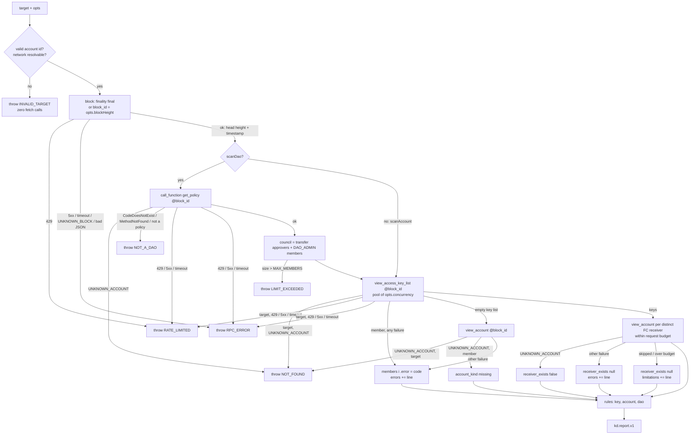

# GĐ1 design: `scanAccount`, `scanDao`, rules, RPC client

Scope: `docs/final-idea.md:866` (GĐ1: `rpc.ts`, `scanAccount`, `scanDao`, the §5.1 rules, `messages`). Contracts: `packages/key-doctor/src/types.ts` (unchanged; `Flag.rule_id` stays `string`, `types.ts:51`). The done-when "scan the 20 prototype accounts" (`final-idea.md:866`) is replaced by owner decision 2026-10-29: a fixture corpus with one positive and one negative case per §5.1 rule, plus one live testnet scan the owner runs. Lane: high-risk (`rpc.ts` is in `.claude/dev-team.md` `high_risk`).

## 1. Flow

## 2. Modules (all new under `packages/key-doctor/src/`)

| File | Owns |
|---|---|
| `rpc.ts` | `createRpc({ url, fetchImpl })`: the only `fetch` caller. Methods `block`, `viewAccessKeyList`, `viewAccount`, `callFunction`. Maps transport and JSON-RPC errors to `KdErrorException`. |
| `errors.ts` | `KdErrorException` (extends `Error`, field `kd: KdError`), `isKdError`, fixed vi/en text per code (`final-idea.md:503-518`). |
| `parse.ts` | Target validation, account kind, raw key to `KeyInfo`, raw policy to roles. |
| `age.ts` | Nonce split and age estimate (section 5). |
| `messages.ts` | One `(evidence) => Messages` per rule id. |
| `rules/thresholds.ts` | `RULESET_VERSION = "2026-11-01"` and every number in sections 5 and 6. |
| `rules/key.ts`, `rules/account.ts`, `rules/dao.ts`, `rules/index.ts` | Pure rule functions; `index.ts` runs them in §5.1 order. |
| `scan.ts` | `scanAccount`, `scanDao`, the hand-written pool, the request budget, summary. |
| `index.ts` | Adds value exports beside today's `export type * from "./types.ts"` (`index.ts:3`). |

## 3. RPC calls and their error paths

Requests are `POST` to one URL with body `{jsonrpc:"2.0", id:"kd", method, params}`. The URL is `opts.rpcUrl`, else `https://rpc.testnet.near.org` or `https://rpc.mainnet.near.org` by network. The first call is `block`. Every later call carries `block_id: <head height>` (`final-idea.md:564`, `usecase.md:144`). There are no retries. Each request has a 15 s `AbortController` timer that stays armed until the body is parsed, so a stalled body read also times out.

Transport mapping (all calls): HTTP 429 → `RATE_LIMITED`, retryable. HTTP 5xx, abort, network failure, non-JSON body, or a body with neither `result` nor `error` → `RPC_ERROR`, retryable. JSON-RPC `error.cause.name`: `UNKNOWN_BLOCK` → `RPC_ERROR`, retryable; `UNKNOWN_ACCOUNT` → `NOT_FOUND`; `NO_CONTRACT_CODE` → `NOT_A_DAO` (call_function only); any other cause → `RPC_ERROR`, not retryable. A `call_function` failure can also come back as `result.error` (a string). If that string contains `CodeDoesNotExist` or `MethodNotFound` it maps to `NOT_A_DAO`, otherwise to `RPC_ERROR`, not retryable. The cause names are recalled from the NEAR RPC docs. The owner's live run records one real error body per cause.

| Call | On throw / error field | Report | `errors[]` | `members[].error` | `limitations` |
|---|---|---|---|---|---|
| `block` | any | none, the scan throws the mapped `KdError` | n/a | n/a | n/a |
| `call_function get_policy` (scanDao) | any | none, throws (`NOT_FOUND`, `NOT_A_DAO`, `RATE_LIMITED`, `RPC_ERROR`). A result whose bytes do not decode to JSON with a `roles` array also throws `NOT_A_DAO`. | n/a | n/a | n/a |
| `view_access_key_list`, target of scanAccount | `UNKNOWN_ACCOUNT` | none, throws `NOT_FOUND` | n/a | n/a | n/a |
| same | other | none, throws the mapped error. A one-member report with no data is not useful. | n/a | n/a | n/a |
| `view_access_key_list`, DAO member | any | yes | `member <id>: <CODE>` | `<CODE>` (`RATE_LIMITED` or `RPC_ERROR`), `keys: []`, `flags: []` | none |
| `view_account` after an empty key list | `UNKNOWN_ACCOUNT` | target: throws `NOT_FOUND`. Member: `account_kind: "missing"`, `error: null`, no flags. | none | null | none |
| same | other | target: throws. Member: as a failed key list. | `member <id>: <CODE>` | `<CODE>` | none |
| `view_account`, FC receiver | `UNKNOWN_ACCOUNT` | `receiver_exists: false` on every key with that receiver | none | null | none |
| same | other | `receiver_exists: null` | `receiver <id>: <CODE>` | null | none |
| same | not sent (`skipReceiverCheck` or budget) | `receiver_exists: null` | none | null | `Some function-call key receivers were not checked.` (once) |

The empty-list follow-up is there because `view_access_key_list` may return `keys: []` for an account that does not exist instead of `UNKNOWN_ACCOUNT`. The design handles both shapes. A receiver that equals the DAO being scanned gets `receiver_exists: true` with no request. `errors[]` and `members[].error` hold only a code from the closed set plus a validated account id. They never hold RPC text.

## 4. Council, vote policy, DAO block

Sputnik v2 facts. These are recalled from `sputnik-dao-contract/sputnikdao2/src/policy.rs` and were not checked against the source here, because this container cannot reach the network. The owner checks them during the live run.
- A permission matches `kind:action` when the role lists `kind:action`, `kind:*`, `*:action` or `*:*` (`Policy::can_execute_action`).
- The vote policy for a role and kind is `role.vote_policy[label]`, else `default_vote_policy`. This confirms the orchestrator default.
- `WeightOrRatio::to_weight(total)`: `Weight(w)` → `min(w, total)`. `Ratio(n, d)` → `min(floor(n*total/d) + 1, total)`. The pass threshold is `max(quorum, to_weight)`.

`approvals_needed(role, label)` returns that number only when the role kind is `Group` and `weight_kind` is `RoleWeight`, where `total` is the group size. In every other case it returns `null`. Check: `[1,2]` on 3 members gives 2, matching `fixtures/reports/dao-kd-demo.report.json:41`.

- `dao.roles`: every policy role in policy order. Kind lowercased (`Everyone` → `everyone`, `{Group}` → `group`, `{Member}` → `member`). `members` is the group list, or `[]` for other kinds. `can_approve_transfer` is true when the role matches `transfer:VoteApprove`.
- `dao.transfer_vote_policy`: one entry per role with `can_approve_transfer`: `{role, weight_kind, threshold (verbatim), approvals_needed}`.
- `dao.proposal_bond_yocto`: `policy.proposal_bond`, as a string.
- Admin role: a role that matches `L:VoteApprove` for some `L` in `policy`, `policy_add_or_update_role`, `policy_remove_role`, `policy_update_default_vote_policy`, `policy_update_parameters`, with `approvals_needed(role, L) === 1` (owner decision 3).
- Council: the distinct union of `Group` members of transfer-approving roles and of admin roles. `council_size` is its size. `Member.roles` lists the role names that hold the member, in policy order.
- A transfer-approving role that is not a `Group` adds the limitation `Role <name> lets non-listed accounts approve transfers; they are not scanned.`

## 5. Key parsing and age

- Curve from the key prefix: `ed25519:` → `ed25519`, `mldsa65:` → `ml_dsa`, else `unknown`. The ML-DSA prefix is a placeholder (`fixtures/README.md:14`). The owner's live run confirms it.
- `"FullAccess"` → `{type:"full_access"}`. `{FunctionCall:{allowance, receiver_id, method_names}}` → `function_call` with `allowance_yocto = allowance` (null stays null).
- `nonce` is kept as `String(n)` and split with `BigInt`: `h = nonce / 10^6`, `uses = nonce % 10^6` (`final-idea.md:564`). Today's heights give nonces near 1.8e14, below 2^53, so `JSON.parse` keeps them exact.
- Constants in `thresholds.ts`:
  - `BLOCK_TIME_MS = 1200` (owner decision 4, `fixtures/README.md:16`).
  - `GENESIS_HEIGHT = { mainnet: 9820210, testnet: 42376888 }`. These are the `genesis_height` values of the NEAR genesis configs, recalled and not verified. The owner checks them with `EXPERIMENTAL_genesis_config`.
- Known age when `GENESIS_HEIGHT[network] <= h <= head`: `source: "nonce_estimate"`, `block_height: h`, `at = block_timestamp - (head - h) * BLOCK_TIME_MS`, `age_days = floor((head - h) * BLOCK_TIME_MS / 86_400_000)`, `use_count = uses`.
- Unknown age when `h < GENESIS_HEIGHT[network]` or `h > head`. Keys added before the nonce-equals-block-height change (mid-2021, `final-idea.md:564`) carry a small counter, so their `h` falls below genesis. The result is `source: "unknown"`, `block_height: null`, `at: null`, `age_days: null`. `use_count` is `uses` when `h === 0` (the nonce is a plain counter), else `null`.
- Times are ISO 8601 UTC with whole seconds (`2026-07-24T03:17:56Z`, `dao-kd-demo.report.json`, member c). `block_timestamp` comes from `header.timestamp_nanosec`.
- The limitation `Key age is estimated from the access-key nonce.` is always present (`dao-kd-demo.report.json:420`).

## 6. Rules (`final-idea.md:523-539`)

"FA" means full-access. `n_ed` is the number of Ed25519 FA keys, `n_ml` the number of ML-DSA keys. Every threshold lives in `thresholds.ts`.

| Rule | Fires when | Scope, key `flag_ids` |
|---|---|---|
| `FA_MANY` high | `n_ed >= FA_MANY_MIN (5)` | account; on each Ed25519 FA key |
| `DAO_ADMIN` high | member of an admin role (section 4), scanDao only | dao, `account_id` set; in `member.flags`; no key ids |
| `FC_DAO_VOTE` high | council member's FC key with `receiver_id === daoId` and (`method_names` empty or contains `act_proposal`), scanDao only | key |
| `FA_MULTIPLE` cleanup | `FA_MULTIPLE_MIN (2) <= n_ed` and `FA_MANY` did not fire | account; on each Ed25519 FA key |
| `PQ_PARTIAL` cleanup | `n_ml >= 1` and `n_ed >= 1` | account; on each Ed25519 FA key |
| `FA_OLD` cleanup | FA key with `age_days > FA_OLD_DAYS (730)` or `created.source === "unknown"` | key |
| `KEY_UNUSED` cleanup | any key kind with `use_count === 0` | key |
| `FC_UNLIMITED_ALLOWANCE` cleanup | FC key with `allowance_yocto === null` | key |
| `FC_ANY_METHOD` cleanup | FC key with `method_names` empty | key |
| `FC_DEAD_RECEIVER` cleanup | `receiver_exists === false` (missing account only) | key |
| `FA_BOT_LIKE` cleanup | FA key with `use_count >= FA_BOT_LIKE_USES (1000)` | key |
| `PQ_NONE` note | `keys.length >= 1` and `n_ml === 0` | account; no key ids (`dao-kd-demo.report.json:88-163`) |
| `COUNCIL_SMALL` note | `1 <= council_size <= COUNCIL_SMALL_MAX (2)` | dao, in `dao_flags` |

`DAO_ADMIN` sits in `member.flags`, so the member's status rises to high. The dashboard "DAO flags" section (`docs/design/dashboard/README.md:95`) shows `dao_flags` plus every member flag with `scope: "dao"`.

Ordering: `member.flags` by severity (high, cleanup, note), then §5.1 table order, then key order. Key `flag_ids` follow §5.1 table order. Keys keep RPC order. All of this matches `dao-kd-demo.report.json:88-163, 305-307`.

Each flag's `evidence` holds only the numbers its message uses, for example `{full_access_ed25519: 5}` (`dao-kd-demo.report.json:173-175`). `messages.ts` maps that evidence to vi and en text.

## 7. Status, summary, counts, sort

- `member.status`: the highest severity in `member.flags`, else `ok`. A member with `error !== null` gets `note`. A member with only note flags is `note`.
- `member.counts`: `full_access` counts FA keys of any curve, `function_call` counts FC keys, `ml_dsa` counts keys with curve `ml_dsa` and any permission, `unused` counts keys with `use_count === 0`. `pq_ready = n_ml >= 1 && n_ed === 0`.
- `summary.status`: the highest of all `member.status` values and all `dao_flags` severities, else `ok`. In other words, the DAO's level is its weakest member's level (`usecase.md:148`).
- `council_size`: the section 4 size. An account target gives `0` (`account-b.report.json:16`).
- `members_scanned`: members with `error === null`, so a UI can say "2 of 3 read".
- `members_high`, `members_cleanup`, `members_ok`: counts over members with `error === null` and that status. Note-status members are in none of them (b is cleanup despite PQ_NONE, `dao-kd-demo.report.json:263`).
- `pq_ready`, `keys_total`, `keys_full_access`, `keys_unused`: sums over members with `error === null` (`dao-kd-demo.report.json:46-57`: 1, 8, 7, 2).
- Member sort: first `error === null`, ordered high, cleanup, note, ok; then errored members; ties broken by `account_id` in code-unit order.
- With the same block and the same RPC answers, the output is identical apart from `generated_at` (`usecase.md:162`).

## 8. Target validation and network

- Account id regex (NEAR rules, length 2 to 64): `^(?=.{2,64}$)(([a-z\d]+[-_])*[a-z\d]+\.)*([a-z\d]+[-_])*[a-z\d]+$`. Input is trimmed and lowercased first.
- `account_kind`: 64 lowercase hex → `implicit`, which is scanned. `0x` plus 40 hex → `eth_implicit`, which as a target gives `INVALID_TARGET` with the reason "Ethereum-style accounts are not supported". Else `named`. Members that are eth-implicit are scanned like any other member.
- Network: a `.testnet` suffix gives testnet, a `.near` suffix gives mainnet. A suffix that conflicts with `opts.network` gives `INVALID_TARGET`. With no suffix (implicit ids or other top-level names), the network is `opts.network ?? "testnet"`.
- The `INVALID_TARGET` text never echoes the input. Messages name an account only after the id passed the regex.
- `NOT_A_DAO` comes only from `scanDao`. The dashboard tries `get_policy` and falls back to an account scan (`docs/design/dashboard/README.md:38`, `usecase.md:143`).

## 9. Security notes for `rpc.ts`

1. Validation runs before any fetch. An invalid target makes zero `fetch` calls. Member and receiver ids read from chain data pass the same regex before they go into a request. An invalid one becomes member error `INVALID_ACCOUNT_ID`, or `receiver_exists: null`, with no request sent.
2. Error text is a fixed string per code. No URL is echoed, because an `rpcUrl` can hold a provider API key. No response body, `error.data` or `error.message` is echoed. Nothing is logged.
3. `opts.rpcUrl` is caller configuration. The Worker and MCP must never pass user input into it, because that would be server-side request forgery. Callers in GĐ3/GĐ4 note this.
4. Bounded request count. `REQUEST_BUDGET = 45` (the free-plan outbound-call cap, `final-idea.md:727`, is 50 on the Cloudflare free plan; 5 are left for the Worker's own Telegram calls). `MAX_MEMBERS = 40`: a larger council throws `LIMIT_EXCEEDED`, not retryable, before any key-list read.
   - Count per scan: `1 (block) + 1 (get_policy, DAO only) + M (key lists) + E (empty-list follow-ups) + R (receivers)`. Receivers get `REQUEST_BUDGET - used` slots. Receivers past that are skipped, in sorted id order, and get the limitation line (`usecase.md:147`). This applies to every path, because no path retries.
   - Worst-case time, with every request hitting the 15 s timeout and the default concurrency of 4: block and get_policy run in sequence (30 s), then 40 key lists take 10 rounds (150 s), then the last 3 requests take 1 round (15 s). Total about 195 s. `concurrency` is clamped to 1..8.
5. The policy bytes are decoded with `TextDecoder` and `JSON.parse` inside try/catch, then shape-checked. A bad shape throws `NOT_A_DAO`.

## 10. Slices

Each slice can be demoed alone: a stubbed `fetch` answers by `method` and `params.request_type` from the fixture files, and `npm run typecheck` passes.

### S1: `scanAccount` with key and account rules

Files: `rpc.ts` (`block`, `viewAccessKeyList`, `viewAccount`), `errors.ts`, `parse.ts`, `age.ts`, `messages.ts`, `rules/thresholds.ts`, `rules/key.ts`, `rules/account.ts`, `rules/index.ts`, `scan.ts` (`scanAccount`), `index.ts`.
New fixtures: `fixtures/rpc/block.json` (height 182340111, `timestamp_nanosec` `"1793671210000000000"`), `fixtures/rpc/error.unknown_account.json`, `fixtures/rpc/error.unknown_block.json`, `fixtures/rpc/view_account.empty-target.json`.

- S1-AC1: `scanAccount("b.kd-demo.testnet")`, given the block and `view_access_key_list.b.json`, returns `kd.report.v1` with `target.type: "account"`, `chain.block_height: 182340111`, and one member. Every query after `block` carries `block_id: 182340111`.
- S1-AC2: these rules fire per section 6: `FA_MANY`, `FA_MULTIPLE` (suppressed by `FA_MANY`), `PQ_PARTIAL`, `PQ_NONE`, `FA_OLD`, `KEY_UNUSED`, `FA_BOT_LIKE`. They run over one account's keys.
- S1-AC3: age per section 5. A nonce below `GENESIS_HEIGHT[network] * 10^6`, or one whose height is above the head, gives `source: "unknown"`, and an FA key with that age gets `FA_OLD`.
- S1-AC4: an invalid id, a `0x` id, or a suffix that conflicts with `opts.network` throws `INVALID_TARGET` with zero `fetch` calls.
- S1-AC5: transport errors map per section 3 (429, 5xx, timeout after 15 s, `UNKNOWN_BLOCK`, `UNKNOWN_ACCOUNT`, and an empty list followed by `view_account` `UNKNOWN_ACCOUNT`). `isKdError` is true on each throw. Neither the error message nor `kd.message` contains the URL or any response body text.
- S1-AC6: `summary` and `counts` follow section 7 for one member, with `council_size: 0`.

### S2: function-call rules and receiver checks

Files: `rpc.ts` (receiver use of `viewAccount`), `rules/key.ts`, `messages.ts`, `scan.ts` (dedupe, budget, `skipReceiverCheck`).
New fixtures: `fixtures/rpc/view_account.game.json` (new, the receiver of b's app key).

- S2-AC1: `FC_UNLIMITED_ALLOWANCE`, `FC_ANY_METHOD` and `FC_DEAD_RECEIVER` fire per section 6 over one account's FC keys.
- S2-AC2: distinct receivers are checked once each. `UNKNOWN_ACCOUNT` gives `false`. Other failures give `null` plus an `errors[]` line. `skipReceiverCheck` or an exhausted budget gives `null`, no request, and one limitation line.
- S2-AC3: `scanAccount("b.kd-demo.testnet")` deep-equals `fixtures/reports/account-b.report.json` except `generated_at`.

### S3: `scanDao`

Files: `rpc.ts` (`callFunction`), `rules/dao.ts`, `rules/index.ts`, `messages.ts`, `scan.ts` (`scanDao`, pool, `MAX_MEMBERS`), `index.ts`.
Fixture work: the drift fix from `docs/design/dashboard/README.md:102`. Add an app key to `fixtures/rpc/view_access_key_list.a.json` (`game.kd-demo.testnet`, any method, unlimited, nonce `165000000000031`). Add the new `fixtures/rpc/view_access_key_list.c.json` (the ML-DSA FA key from the report). Update `dao-kd-demo.report.json`: member a gains the FC key, its `FC_UNLIMITED_ALLOWANCE`, `FC_ANY_METHOD`, and `FA_OLD` on keys at heights 120300000 and 101200000 (861 and 1126 days). Totals become `keys_total: 9`, `keys_full_access: 7`.

- S3-AC1: `scanDao("kd-demo.sputnik-dao.testnet")` deep-equals the updated `dao-kd-demo.report.json` except `generated_at`.
- S3-AC2: council, `dao.roles`, `transfer_vote_policy` and `approvals_needed` follow section 4 over one DAO's policy roles.
- S3-AC3: `DAO_ADMIN`, `FC_DAO_VOTE` and `COUNCIL_SMALL` fire per section 6. `FC_DAO_VOTE` runs over council members' FC keys whose receiver is the scanned DAO.
- S3-AC4: a member key-list failure sets that member's `error`, its sort position and its summary exclusion per section 7. The scan still returns a report.
- S3-AC5: `get_policy` errors map per section 3, including `result.error` strings. A council above 40 throws `LIMIT_EXCEEDED` before any key-list read. No more than 4 requests are in flight at once at the default concurrency, and no scan sends more than 45 requests.

### S4: rule corpus

Files: `fixtures/corpus/<RULE_ID>.pos.json` and `.neg.json` (26 files). Each holds `{target, scan: "account" | "dao", network: "testnet", responses: {...}, rule: "<RULE_ID>", fires: true | false}`. Responses use the raw JSON-RPC shape of `fixtures/rpc/`. Names are under `kd-corpus.testnet` and `*.kd-corpus.sputnik-dao.testnet`. Negative cases sit just under the threshold: 4 Ed25519 FA keys for `FA_MANY`, 1 for `FA_MULTIPLE`, 730 days for `FA_OLD`, 999 uses for `FA_BOT_LIKE`, 3 members for `COUNCIL_SMALL`, a threshold needing 2 votes for `DAO_ADMIN`, an FC key into the DAO limited to `add_proposal` for `FC_DAO_VOTE`.

- S4-AC1: each of the 13 rules has one positive and one negative corpus case. Scanning each case returns a report where the rule's presence equals `fires`.
- S4-AC2: `fixtures/README.md` lists the corpus and says which values the owner's live testnet scan confirmed.

Build order: S1 → S2 → S3 → S4. S1 owns `errors.ts`, `parse.ts`, `age.ts`, `thresholds.ts` and the `index.ts` exports (`scanAccount`, `KdErrorException`, `isKdError`, `RULESET_VERSION`). S3 adds `scanDao` to `index.ts`. One builder per slice. No file is edited in parallel.
