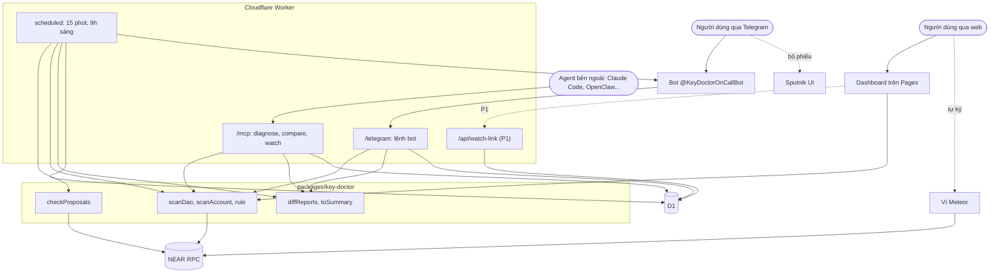

# Key Doctor: bản chốt cho NEAR Hackathon

| | |
|---|---|
| Trạng thái | **Bản chốt** (2026-10-29), thay cho bản 2026-10-28 |
| Cuộc thi | NEAR HACKATHON "Build Beyond Boundaries", build 1/11 đến 14/11/2026 (hạn 23:59 UTC 14/11) |
| Team | TuTM (Trần Minh Tú), DuongHB. Toàn bộ code do Claude Code viết theo tài liệu này |
| Tên | Sản phẩm **Key Doctor**. Tính năng canh quỹ **On Call** ("Key Doctor On Call"). Bot `@KeyDoctorOnCallBot` |
| Tài liệu đi kèm | `usecase.md`: 8 use case, sơ đồ trình tự. `near-hackathon.md`: luật và yêu cầu chính thức của cuộc thi. `proposal-key-doctor.md` (bản v2): số liệu, hạng mục #1 đến #18 của lõi Key Doctor |

> **Thứ tự ưu tiên khi tài liệu mâu thuẫn:** file này > `usecase.md` > `proposal-key-doctor.md`. Các điểm thay đổi so với v2 ở mục 3.
>
> **Nguyên tắc làm việc:** file này định nghĩa thành phần, hợp đồng dữ liệu, mức ưu tiên, thứ tự build và tiêu chí xong. Không chia việc theo người: Claude Code làm theo **thứ tự giai đoạn ở mục 13**.

---

## 0. Tóm tắt một trang

**Vấn đề.** Trên NEAR, public key của mọi access key đều công khai. Số liệu đo trên 632 DAO còn hoạt động: council trung vị chỉ 1 người, 4/480 thành viên council có khóa chống lượng tử ML-DSA và cả 4 vẫn giữ khóa Ed25519 toàn quyền cũ, 83% function-call key chưa từng dùng. Khi một thành viên council bị chiếm tài khoản, kẻ gian thường **thêm một khóa toàn quyền của riêng chúng**, rồi bỏ phiếu duyệt rút quỹ hoặc đổi luật DAO. Ví chỉ thấy tài khoản của chính người dùng, không theo dõi đề xuất DAO, không nối khóa với phiếu bầu.

**Sản phẩm, hai lớp:**

1. **Khám và dọn khóa:** đọc khóa của một account hoặc cả council DAO, giải thích từng khóa bằng lời thường, chấm rủi ro bằng rule viết bằng code. **Dọn khóa thừa ngay trên dashboard** (Key Doctor dựng giao dịch, người dùng ký bằng ví); bước thêm khóa chống lượng tử làm trong ví Meteor theo hướng dẫn.
2. **On Call (canh quỹ):** Worker tự kiểm tra mỗi 15 phút. Khi DAO có đề xuất chi tiền hoặc thay đổi quyền, và người vừa bỏ phiếu có khóa toàn quyền mới xuất hiện gần đây, bot Telegram cảnh báo council **trước phiếu cuối**. Kèm so khóa council hằng ngày.

Kèm theo: **MCP server** để agent bất kỳ (Claude Code, OpenClaw...) dùng được Key Doctor. Đã kiểm với Claude Code.

**Nguyên tắc:**

- Không thành phần nào giữ khóa của ai, không ký giao dịch thay ai. Dashboard chỉ **dựng** giao dịch dọn khóa; người dùng tự ký trong ví.
- **Code quyết định mọi kết luận.** Không dùng LLM trong sản phẩm.
- Chỉ Worker cron được dời mốc so sánh.
- **Đăng ký theo dõi có một nguồn duy nhất:** bảng `subscriptions` trong D1, chỉ Worker được ghi.
- Bot Telegram là kênh báo động duy nhất.

**Track:** `social` (chính) + `security` (phụ). Luật cho chọn nhiều track trong một bài nộp (xem `near-hackathon.md`).

**Câu giới thiệu:**

- *"Key Doctor checks your council's keys, and stays on call while you sleep."*
- *"Key Doctor khám khóa cho council, và trực cả lúc bạn ngủ."*

---

## 1. Kiến trúc, thành phần, nơi chạy



### 1.1 Thành phần, mức ưu tiên, giai đoạn

| Thành phần | Mức | Giai đoạn (mục 13) |
|---|---|---|
| Repo monorepo (pnpm workspaces), `types.ts`, fixture, `pnpm test` | P0 | GĐ0 |
| Thư viện: `rpc.ts`, `scanAccount`, `scanDao`, bộ rule khóa, `messages` | P0 | GĐ1 |
| Thư viện: `diffReports`, `toSummary` | P0 | GĐ2 |
| Worker: MCP `diagnose`, `compare`; D1 `snapshots`; xác thực header Bearer | P0 | GĐ3 |
| Worker: bot (`/check`, `/changes`, `/watch`, `/unwatch`, `/list`, `/help`), `subscriptions` | P0 | GĐ4 |
| Thư viện: `checkProposals` | P0 | GĐ5 |
| Worker: job canh đề xuất, `proposal_state`, `alerts_sent`, `/run-check`; script demo testnet | P0 | GĐ6 |
| Dashboard: nhập, council, hồ sơ account, nút "Nhận cảnh báo" (MVP) | P0 | GĐ7 |
| Dashboard: kế hoạch dọn khóa (UC8), xóa khóa theo lô qua ví | P0 | GĐ8 |
| Worker: job so khóa hằng ngày (UC7) | P0 | GĐ9 |
| Số liệu toàn mạng + script tái lập | P0 | GĐ10 |
| Chạy ngược rule trên lịch sử (mục 14.1) | P1 | GĐ11 |
| Tool `watch` + `/start` deep link, `/api/watch-link`, nút dashboard bản P1 | P1 | GĐ12 |
| Ngày tạo khóa từ NearBlocks, rule mở rộng | P1 | GĐ13 |
| README, video, nộp bài | P0 | GĐ14 |

### 1.2 Nơi chạy

| Thành phần | Chạy ở đâu |
|---|---|
| Worker + D1 | Cloudflare Workers (gói miễn phí) + D1 |
| Dashboard | Cloudflare Pages (trang tĩnh; quét chạy trong trình duyệt) |
| Thư viện `key-doctor` | Không deploy riêng; đóng gói vào dashboard và Worker |
| Script số liệu, chạy ngược lịch sử | Chạy trên máy; kết quả và script để trong repo |
| Bot | Telegram; Worker nhận lệnh qua webhook, gửi tin qua Bot API |

Dùng **chung một tài khoản Cloudflare** cho cả team.

---

## 2. Tám use case (chi tiết trong `usecase.md`)

| UC | Tên | Ai bắt đầu | Đường đi | Mức | Giai đoạn |
|---|---|---|---|---|---|
| 1 | Khám qua web | Người dùng | Dashboard → `scanDao` → RPC | P0 | GĐ1, GĐ7 |
| 2 | Kiểm tra qua bot hoặc agent | Người dùng | `/check` trên bot, hoặc `diagnose` qua MCP | P0 | GĐ3, GĐ4 |
| 3 | Xem thay đổi | Người dùng | `/changes` trên bot, hoặc `compare` qua MCP (không dời mốc) | P0 | GĐ2 đến GĐ4 |
| 4 | Đăng ký qua bot | Người dùng | `/watch` → `/telegram` → D1 | P0 | GĐ4 |
| 5 | Đăng ký qua dashboard hoặc agent | Người dùng | MVP: nút mở bot kèm lệnh. P1: link xác nhận | P0 (MVP) / P1 (link) | GĐ7 / GĐ12 |
| 6 | **Canh đề xuất** (15 phút) | Worker cron | Cron → `checkProposals` → bot | P0 | GĐ5, GĐ6 |
| 7 | So khóa hằng ngày | Worker cron | Cron → `scanDao` → `diffReports` → bot | P0 | GĐ9 |
| 8 | Dọn khóa | Người dùng | Dashboard dựng giao dịch xóa khóa → ví ký; thêm ML-DSA trong Meteor → quét lại | P0 | GĐ8 |

---

## 3. Quyết định và thay đổi

### 3.1 So với `proposal-key-doctor.md` (v2)

| # | Mục trong v2 | Thay đổi | Trạng thái |
|---|---|---|---|
| T1 | #11 MCP `diagnose` (P1) | Lên **P0**, thêm `compare` (P0), `watch` (P1). Chạy trên Cloudflare Workers | Đã chốt |
| T2 | #18 Theo dõi nhẹ (P2); 5.4 "không giám sát" | Thay bằng UC7 trên Worker cron | Đã chốt |
| T3 | (không có) | Thêm UC6 canh đề xuất; `checkProposals` nằm trong thư viện | Đã chốt |
| T4 | 10.2 phân công | Bỏ phân công theo người; làm theo giai đoạn mục 13 | Đã chốt |
| T5 | Mục 8 bộ rule | Đề xuất thêm `FC_DAO_VOTE`, `FA_BOT_LIKE`, `COUNCIL_SMALL` | Cần chốt |
| T6 | #6 Đăng nhập NEP-413 | Bỏ đăng nhập. Dashboard chỉ **kết nối ví** khi người dùng bấm dọn, để ví ký giao dịch xóa khóa; tiến độ đọc từ chain | Chờ kết quả thử ký (mục 13.5) |
| T7 | #1 bỏ qua implicit | Implicit (hex) có tiền vẫn đọc được khóa; cần xử lý riêng account `0x...` | Cần kiểm |
| T8 | 13.2 track | `social` (chính) + `security` (phụ). Luật chính thức cho chọn nhiều track | Đã chốt |
| T9 | 5.4 không cấp khóa cho agent | Giữ nguyên; Agent Guard vào Roadmap | Đã chốt |
| T10 | Màn hình | Thêm nút "Nhận cảnh báo qua Telegram" | Đã chốt |
| T11 | Ví dụ DAO thật trong prototype | Bản public và demo chỉ dùng testnet | Đã chốt |
| T12 | (không có) | P1: chạy ngược rule canh đề xuất trên lịch sử 12 tháng | Đã chốt |

### 3.2 Đã cân nhắc và bỏ

| Phương án | Lý do bỏ |
|---|---|
| Agent IronClaw | IronClaw chuyển vào near.com, không còn là sản phẩm riêng. MCP vẫn giữ cho agent bên ngoài |
| Trợ lý AI trong bot (NEAR AI Cloud) | Với bộ lệnh cố định, code tự xử lý được; AI không thêm giá trị đáng kể |
| Xác thực MCP bằng token trong đường dẫn | Đã kiểm: header Bearer chạy tốt với Claude Code |
| Webhook từ Worker vào agent | Kênh báo động phải độc lập với agent |
| Agent Guard trong bài thi | Quá tải; để Roadmap |

### 3.3 Kết quả đã kiểm (task hello)

| Câu hỏi | Kết quả |
|---|---|
| MCP server trên Cloudflare Workers | Chạy, tại `kd-hello.<account>.workers.dev` |
| Đường MCP | `/mcp` (Streamable HTTP) |
| Xác thực | Header `Authorization: Bearer <token>` |
| Agent đã kiểm | Claude Code (`claude mcp add --transport http ... --header ...`) |
| `ping_near` testnet và mainnet | Cần xác nhận lại nếu chưa chạy |

---

## 4. Hợp đồng dữ liệu (định dạng JSON)

Nguồn chuẩn: `packages/key-doctor/src/types.ts`. Muốn đổi thì tăng `schema_version` và báo người kia.

| Định dạng | Sinh bởi | Dùng bởi |
|---|---|---|
| `kd.report.v1` | `scanDao`, `scanAccount` | Dashboard, bot `/check`, `diagnose` (full), bản chụp D1 |
| `kd.report_summary.v1` | `toSummary` | `diagnose` (summary) |
| `kd.diff.v1` | `diffReports` | `/changes`, `compare`, UC7 |
| `kd.alert.v1` | `checkProposals` | Worker gửi bot, bảng chống trùng |
| `ProposalWatchState` | `checkProposals` | Worker lưu D1 |
| `kd.watch_link.v1` | Worker | Tool `watch`, `/api/watch-link` |
| `kd.error.v1` | Worker | Mọi tool và endpoint khi lỗi |

Quy ước chung: mức độ `high` / `cleanup` / `note`; yoctoNEAR là chuỗi; thời gian ISO 8601 UTC.

### 4.1 `kd.report.v1`

```ts
export type Severity = "high" | "cleanup" | "note";
export type Status = Severity | "ok";
export type Network = "mainnet" | "testnet";

export interface Messages {
  vi: { title: string; explain: string; fix: string };
  en: { title: string; explain: string; fix: string };
}

export type KeyPermission =
  | { type: "full_access" }
  | {
      type: "function_call";
      receiver_id: string;
      method_names: string[];          // rỗng = gọi được mọi hàm
      allowance_yocto: string | null;  // null = không giới hạn
    };

export interface KeyInfo {
  public_key: string;
  curve: "ed25519" | "ml_dsa" | "unknown";
  permission: KeyPermission;
  receiver_exists?: boolean | null;
  nonce: string;
  use_count: number | null;
  created: {
    block_height: number | null;       // phần nguyên của nonce / 10^6
    at: string | null;
    source: "nonce_estimate" | "indexer" | "unknown";
  };
  age_days: number | null;
  flag_ids: string[];
}

export interface Flag {
  rule_id: string;
  severity: Severity;
  scope: "key" | "account" | "dao";
  account_id?: string;
  public_key?: string;
  evidence: Record<string, unknown>;
  messages: Messages;                  // bot và dashboard chỉ dùng lại
}

export interface Member {
  account_id: string;
  account_kind: "named" | "implicit" | "eth_implicit" | "missing";
  roles: string[];
  status: Status;
  pq_ready: boolean;                   // có ML-DSA VÀ không còn Ed25519 full-access
  counts: { full_access: number; function_call: number; ml_dsa: number; unused: number };
  keys: KeyInfo[];
  flags: Flag[];
  error: string | null;
}

export interface TransferVotePolicy {
  role: string;
  weight_kind: string;
  threshold: unknown;                  // nguyên văn từ get_policy
  approvals_needed: number | null;
}

export interface KdReport {
  schema_version: "kd.report.v1";
  ruleset_version: string;
  generated_at: string;
  chain: { network: Network; block_height: number; block_timestamp: string };
  target: { type: "dao" | "account"; id: string };
  dao?: {
    roles: { name: string; kind: "group" | "everyone" | "member"; members: string[]; can_approve_transfer: boolean }[];
    transfer_vote_policy: TransferVotePolicy[];
    proposal_bond_yocto: string;
  };
  summary: {
    status: Status;
    council_size: number;
    members_scanned: number;
    members_high: number;
    members_cleanup: number;
    members_ok: number;
    pq_ready: number;
    keys_total: number;
    keys_full_access: number;
    keys_unused: number;
  };
  members: Member[];                   // target là account: đúng 1 phần tử
  dao_flags: Flag[];
  errors: string[];
  limitations: string[];
}
```

Ví dụ rút gọn:

```json
{
  "schema_version": "kd.report.v1",
  "ruleset_version": "2026-11-01",
  "generated_at": "2026-11-03T02:00:12Z",
  "chain": { "network": "testnet", "block_height": 182340111, "block_timestamp": "2026-11-03T02:00:10Z" },
  "target": { "type": "dao", "id": "kd-demo.sputnik-dao.testnet" },
  "dao": {
    "roles": [{ "name": "council", "kind": "group", "members": ["a.kd-demo.testnet", "b.kd-demo.testnet", "c.kd-demo.testnet"], "can_approve_transfer": true }],
    "transfer_vote_policy": [{ "role": "council", "weight_kind": "RoleWeight", "threshold": [1, 2], "approvals_needed": 2 }],
    "proposal_bond_yocto": "100000000000000000000000"
  },
  "summary": { "status": "high", "council_size": 3, "members_scanned": 3, "members_high": 1, "members_cleanup": 1, "members_ok": 1, "pq_ready": 0, "keys_total": 14, "keys_full_access": 5, "keys_unused": 6 },
  "members": [{
    "account_id": "a.kd-demo.testnet",
    "account_kind": "named",
    "roles": ["council"],
    "status": "high",
    "pq_ready": false,
    "counts": { "full_access": 3, "function_call": 2, "ml_dsa": 0, "unused": 2 },
    "keys": [{
      "public_key": "ed25519:9Zt4...",
      "curve": "ed25519",
      "permission": { "type": "full_access" },
      "nonce": "182330555000000",
      "use_count": 0,
      "created": { "block_height": 182330555, "at": "2026-11-03T00:24:00Z", "source": "nonce_estimate" },
      "age_days": 0,
      "flag_ids": ["FA_MULTIPLE", "KEY_UNUSED"]
    }],
    "flags": [{
      "rule_id": "FA_MULTIPLE",
      "severity": "cleanup",
      "scope": "account",
      "account_id": "a.kd-demo.testnet",
      "evidence": { "full_access_ed25519": 3 },
      "messages": {
        "vi": { "title": "Nhiều khóa toàn quyền", "explain": "Account có 3 khóa toàn quyền. Lộ bất kỳ khóa nào cũng mất cả account.", "fix": "Giữ ít khóa nhất có thể, xóa khóa không dùng." },
        "en": { "title": "Multiple full-access keys", "explain": "...", "fix": "..." }
      }
    }],
    "error": null
  }],
  "dao_flags": [],
  "errors": [],
  "limitations": ["Tuổi khóa ước lượng từ nonce."]
}
```

### 4.2 `kd.report_summary.v1`

```ts
export interface KdReportSummary
  extends Omit<KdReport, "schema_version" | "members"> {
  schema_version: "kd.report_summary.v1";
  members: Omit<Member, "keys">[];
}
```

### 4.3 `kd.diff.v1`

```ts
export type ChangeType =
  | "member_added" | "member_removed" | "role_changed"
  | "key_added" | "key_removed"
  | "flag_raised" | "flag_cleared"
  | "pq_ready_changed";

export interface Change {
  type: ChangeType;
  severity: Severity;
  account_id: string;
  public_key?: string;
  rule_id?: string;
  details?: Record<string, unknown>;
  messages: { vi: string; en: string };
}

export interface KdDiff {
  schema_version: "kd.diff.v1";
  target: { type: "dao" | "account"; id: string };
  network: Network;
  from: { generated_at: string; block_height: number } | null;
  to: { generated_at: string; block_height: number };
  is_baseline: boolean;
  baseline_updated: boolean;
  summary: {
    has_changes: boolean;
    highest_severity: Severity | null;
    status_before: Status | null;
    status_after: Status;
    counts: Partial<Record<ChangeType, number>>;
  };
  changes: Change[];
  limitations: string[];
}
```

Quy ước `diffReports(prev, curr)`: hàm thuần; `prev = null` → `is_baseline: true`, `changes: []`; thành viên có `error` ở một trong hai báo cáo thì bỏ qua và ghi `limitations`; khác `ruleset_version` thì bỏ qua thay đổi về cờ; `key_added` full-access → `high`, khớp `FC_DAO_VOTE` → `high`, `role_changed` thành Admin → `high`, `flag_raised` theo mức rule, còn lại `note`; luôn ghi giới hạn "khóa thêm rồi xóa giữa hai lần quét không thấy".

### 4.4 `kd.alert.v1`

```ts
export type AlertKind =
  | "voter_new_full_access_key"   // người vừa bỏ phiếu có khóa full-access mới
  | "governance_change_proposal"  // thêm/bớt thành viên, đổi policy, đổi config
  | "code_upgrade_proposal"       // nâng cấp contract
  | "daily_changes";              // UC7, do Worker dựng từ kd.diff.v1

export interface ProposalInfo {
  id: number;
  kind_label: string;
  description: string;
  proposer: string;
  transfer?: { token_id: string; receiver_id: string; amount: string };
  status: string;
  votes: Record<string, "Approve" | "Reject" | "Remove">;
  approvals_needed: number | null;
  approvals_have: number;
  pending_voters: string[];
  executed: boolean;
  ui_url: string | null;
}

export interface KdAlert {
  schema_version: "kd.alert.v1";
  alert_id: string;
  created_at: string;
  network: Network;
  target: string;
  severity: Severity;
  kind: AlertKind;
  after_the_fact: boolean;         // true khi đã thực thi (DAO 1 phiếu)
  proposal?: ProposalInfo;
  evidence?: {
    account_id: string;
    public_key: string;
    key_added_block: number;
    key_added_at_est: string;
    hours_before_vote_seen: number;
  };
  diff?: KdDiff;
  messages: {
    vi: { title: string; body: string; action: string };
    en: { title: string; body: string; action: string };
  };
}
```

`alert_id`: `{network}:{target}:{kind}:{proposal_id hoặc ngày}:{account_id hoặc "-"}`.

### 4.5 `checkProposals` và `ProposalWatchState`

```ts
export interface ProposalWatchState {
  last_proposal_id: number;
  pending: Record<string, {           // key = proposal id
    kind_label: string;
    votes_seen: Record<string, "Approve" | "Reject" | "Remove">;
    first_seen_at: string;
  }>;
}

export function checkProposals(
  daoId: string,
  prev: ProposalWatchState | null,
  opts?: {
    network?: Network;
    newKeyWindowHours?: number;       // mặc định 48
    proposalUiUrlTemplate?: string;   // vd "https://<ui>/{dao}/proposals/{id}"
  }
): Promise<{
  alerts: KdAlert[];
  state: ProposalWatchState;
  errors: string[];
}>;
```

Quy ước:

1. Chỉ đọc RPC qua `fetch`. **Không lưu, không gửi** gì.
2. `prev = null`: chỉ ghi nhận đề xuất cuối hiện có, **không trả cảnh báo**.
3. Mỗi lần gọi: đọc `get_last_proposal_id`; đọc `get_proposal` cho đề xuất mới và đề xuất trong `prev.pending`; phân loại; tìm phiếu mới so với `votes_seen`; với người có phiếu mới, gọi `scanAccount` và kiểm khóa full-access có `created.block_height` trong `newKeyWindowHours`; dựng cảnh báo theo mục 5.2.
4. Đề xuất đã kết thúc (không còn `InProgress`) thì bỏ khỏi `pending` trong `state` trả về.
5. Lỗi một đề xuất ghi vào `errors`, không làm hỏng cả lần gọi. Lỗi lấy `get_last_proposal_id` thì throw.
6. `messages` của cảnh báo viết sẵn tiếng Việt và tiếng Anh.

### 4.6 `kd.watch_link.v1`

```json
{
  "schema_version": "kd.watch_link.v1",
  "target": "kd-demo.sputnik-dao.testnet",
  "network": "testnet",
  "link_private": "https://t.me/KeyDoctorOnCallBot?start=Xk3p9QaB7v",
  "link_group": "https://t.me/KeyDoctorOnCallBot?startgroup=Xk3p9QaB7v",
  "expires_at": "2026-11-03T03:45:00Z",
  "instructions": {
    "vi": "Bấm link đầu để nhận cho riêng bạn, link sau để thêm vào nhóm council.",
    "en": "Open the first link for yourself, the second to add the bot to your council group."
  }
}
```

### 4.7 `kd.error.v1`

```ts
export interface KdError {
  schema_version: "kd.error.v1";
  code:
    | "INVALID_TARGET" | "NOT_FOUND" | "NOT_A_DAO"
    | "RPC_ERROR" | "RATE_LIMITED" | "LIMIT_EXCEEDED"
    | "UNAUTHORIZED" | "EXPIRED";
  message: { vi: string; en: string };
  retryable: boolean;
}
```

---

## 5. Bộ rule

Rule viết bằng code, ngưỡng ở `src/rules/thresholds.ts`. Đổi ngưỡng thì đổi `ruleset_version`.

### 5.1 Rule khóa (`scanDao` / `scanAccount`)

| `rule_id` | Mức | Nội dung | Nguồn |
|---|---|---|---|
| `FA_MANY` | high | ≥5 khóa Ed25519 full-access | v2 |
| `DAO_ADMIN` | high | Admin trong policy của DAO đang quét | v2 |
| `FA_MULTIPLE` | cleanup | ≥2 khóa Ed25519 full-access | v2 |
| `PQ_PARTIAL` | cleanup | Có ML-DSA nhưng còn Ed25519 full-access | v2 |
| `FA_OLD` | cleanup | Full-access quá 2 năm hoặc không rõ tuổi | v2 |
| `KEY_UNUSED` | cleanup | Khóa chưa từng dùng | v2 |
| `FC_UNLIMITED_ALLOWANCE` | cleanup | Function-call key chi không giới hạn | v2 |
| `FC_ANY_METHOD` | cleanup | Function-call key gọi mọi hàm | v2 |
| `FC_DEAD_RECEIVER` | cleanup | Contract không tồn tại | v2 |
| `PQ_NONE` | note | Chưa có ML-DSA | v2 |
| `FC_DAO_VOTE` | high | Thành viên council có function-call key vào DAO cho phép `act_proposal` hoặc mọi hàm | Đề xuất (T5) |
| `FA_BOT_LIKE` | cleanup | Full-access dùng rất nhiều lần, nghi bot/agent | Đề xuất (T5) |
| `COUNCIL_SMALL` | note | Council 1 đến 2 người | Đề xuất (T5) |

### 5.2 Rule canh đề xuất (`checkProposals`)

| Tín hiệu | Mức | `kind` |
|---|---|---|
| Người vừa bỏ phiếu có khóa **full-access** thêm trong 48 giờ | high | `voter_new_full_access_key` |
| Đề xuất mới loại `add_member_to_role`, `remove_member_from_role`, `policy`, `policy_*`, `config` | high | `governance_change_proposal` |
| Đề xuất mới loại `upgrade_self`, `upgrade_remote` | high | `code_upgrade_proposal` |

Đề xuất "chi tiền": `transfer` và `call` (`FunctionCall` có thể chuyển token qua `ft_transfer`). Nhãn loại theo `vote_policy` của Sputnik v2, **đối chiếu với mã nguồn** khi code. DAO 1 phiếu: đề xuất thực thi ngay; vẫn cảnh báo với `after_the_fact: true`.

---

## 6. Dữ liệu đọc từ NEAR

| Truy vấn | Gọi cho | Dùng ở |
|---|---|---|
| `block` | Đầu mỗi lần quét | Ghim thời điểm |
| `call_function` `get_policy` | DAO | Council, Admin, ngưỡng phiếu, bond |
| `view_access_key_list` | Thành viên / người bỏ phiếu | Khóa |
| `view_account` | Receiver của khóa hạn chế | `FC_DEAD_RECEIVER` |
| `call_function` `get_last_proposal_id` | DAO | `checkProposals` |
| `call_function` `get_proposal` `{"id": N}` | Đề xuất mới, đang chờ | `checkProposals` |

Nonce: phần nguyên của `nonce / 10^6` là block thêm khóa, phần dư là số lần dùng. Khóa trước khoảng giữa 2021: "không rõ tuổi". Ghim mọi truy vấn một lần quét vào cùng `block_height`.

---

## 7. Thư viện `packages/key-doctor`

```ts
// Lõi quét và canh đề xuất
export function scanDao(daoId: string, opts?: ScanOptions): Promise<KdReport>;
export function scanAccount(accountId: string, opts?: ScanOptions): Promise<KdReport>;
export function checkProposals(/* mục 4.5 */): Promise<{ alerts: KdAlert[]; state: ProposalWatchState; errors: string[] }>;

// So sánh và rút gọn
export function diffReports(prev: KdReport | null, curr: KdReport): KdDiff;
export function toSummary(report: KdReport): KdReportSummary;

export interface ScanOptions {
  network?: Network;
  rpcUrl?: string;
  blockHeight?: number;
  skipReceiverCheck?: boolean;
  concurrency?: number;      // mặc định 4
}
```

Ràng buộc: chỉ dùng `fetch` (chạy được ở trình duyệt, Node, Workers); logic tách khỏi giao diện; câu giải thích nằm trong `messages`; lỗi từng thành viên ghi `members[].error`; mọi rule, `diffReports`, `checkProposals` có test; dữ liệu mẫu ở `fixtures/` (gồm fixture `get_proposal` cho test `checkProposals`).

---

## 8. Worker (`apps/worker`)

Một Cloudflare Worker, gói miễn phí, D1. MCP viết theo mẫu remote MCP của Cloudflare (Streamable HTTP).

### 8.1 Các đường vào

| Đường | Ai gọi | Bảo vệ |
|---|---|---|
| `POST /telegram` | Telegram webhook | Header `X-Telegram-Bot-Api-Secret-Token` |
| `POST /mcp` | Agent bên ngoài | `Authorization: Bearer <MCP_TOKEN>` |
| `POST /api/watch-link` (P1) | Dashboard | CORS chỉ cho `DASHBOARD_ORIGIN` |
| `POST /run-check` | Người demo | `Authorization: Bearer <RUN_CHECK_TOKEN>` |
| `scheduled` | Cloudflare | Nội bộ |
| `GET /` | Bất kỳ | Không; trả "ok" để kiểm Worker sống |

### 8.2 Bot Telegram

| Lệnh | Việc | UC |
|---|---|---|
| `/check <target>` | `scanDao`/`scanAccount`, trả tóm tắt theo mẫu (mục 9.2) + link dashboard. Không đụng D1 | 2 |
| `/changes <target>` | Như `compare` với `update_baseline: false` | 3 |
| `/watch <target>` | Đăng ký cho chat hiện tại | 4 |
| `/unwatch <target>` | Hủy cho chat hiện tại | 4 |
| `/list` | Liệt kê target chat đang theo dõi | 4 |
| `/start <mã>` | Xác nhận đăng ký từ link (UC5) | 5 |
| `/help` | Hướng dẫn | |

**Tin nhắn không phải lệnh:** tìm tên dạng `*.near` / `*.testnet` trong câu bằng regex; tìm được một tên thì chạy như `/check`, không thì gửi `/help`. Không dùng LLM.

**Xử lý webhook:** trả `200` ngay, phần xử lý chạy trong `ctx.waitUntil(...)`, gửi `sendChatAction: typing` trong lúc quét, xong gọi `sendMessage`.

**Khi đăng ký thành công (UC4, UC5):** ghi `subscriptions` (kèm `target_type`); nếu target chưa có mốc thì quét và lưu bản chụp; nếu là DAO và chưa có `proposal_state` thì gọi `checkProposals(dao, null)` và lưu `state` (chỉ báo đề xuất từ lúc đăng ký trở đi). Bước `checkProposals` được thêm ở GĐ6, vì `checkProposals` có từ GĐ5.

### 8.3 MCP server

Ba tool, dùng chung hàm với bot:

| Tool | Tham số | Trả về | Đụng D1 |
|---|---|---|---|
| `diagnose` | `target`, `network?`, `detail?` (`summary` mặc định / `full`) | `kd.report_summary.v1` / `kd.report.v1` | Không |
| `compare` | `target`, `network?`, `update_baseline?` (mặc định `false`) | `kd.diff.v1` | Đọc; ghi khi chưa có mốc hoặc `update_baseline: true` |
| `watch` (P1) | `target`, `network?` | `kd.watch_link.v1` | Ghi `pending_subscriptions` |

Mô tả tool `compare` ghi rõ: "Chỉ đặt update_baseline=true khi được yêu cầu rõ; mặc định không dời mốc."

### 8.4 HTTP endpoint

- **`POST /api/watch-link`** (P1): request `{ "target", "network" }`, response `kd.watch_link.v1`. Dùng chung hàm với tool `watch`.
- **`POST /run-check`**: request `{ "job": "proposals" | "daily", "target"?: string }`. Response `{ "job", "targets_checked", "alerts_sent", "alerts": [alert_id...], "errors": [] }`.

### 8.5 Job canh đề xuất (UC6, mỗi 15 phút)

```
1. Lấy danh sách DAO (bỏ trùng) từ subscriptions có target_type = 'dao',
   DAO lâu chưa kiểm nhất xếp trước, tối đa MAX_DAOS_PER_RUN.
2. Với mỗi DAO:
   a. Đọc state từ proposal_state (không có thì null).
   b. Gọi checkProposals(dao, state, opts).
      Lỗi (throw) → ghi log, KHÔNG lưu state, sang DAO tiếp theo.
   c. Với mỗi alert:
        - alert_id đã có trong alerts_sent → bỏ qua.
        - chưa có → gửi tới MỌI chat đang theo dõi DAO, rồi ghi alerts_sent.
   d. Lưu state mới vào proposal_state.
```

Quy tắc:

- **Quét theo DAO, không theo lượt đăng ký.** Nhiều chat cùng theo dõi một DAO chỉ gọi `checkProposals` một lần.
- **Gửi trước, ghi `alerts_sent` sau:** Worker chết giữa chừng thì gửi trùng một lần, còn hơn bỏ sót.
- **Chat chặn bot / bot bị đá khỏi nhóm** (Telegram trả lỗi tương ứng): xóa đăng ký của chat đó.
- `/run-check` gọi đúng hàm này, có thể truyền một `target`.

### 8.6 Job so khóa hằng ngày (UC7, 9:00 giờ Việt Nam)

Với mỗi target (DAO và account) trong `subscriptions`: đọc mốc → `scanDao`/`scanAccount` → `diffReports` → **lưu bản mới làm mốc** → có thay đổi thì dựng `kd.alert.v1` loại `daily_changes`, gửi tới các chat theo dõi target đó. Không có thay đổi thì im lặng.

**Chỉ hai chỗ được dời mốc:** job này, và lần đăng ký đầu (khi chưa có mốc).

### 8.7 D1

```sql
CREATE TABLE snapshots (
  target TEXT NOT NULL, network TEXT NOT NULL,
  generated_at TEXT NOT NULL, block_height INTEGER NOT NULL,
  report_json TEXT NOT NULL,
  PRIMARY KEY (target, network, generated_at)
);

CREATE TABLE subscriptions (
  target TEXT NOT NULL, network TEXT NOT NULL,
  target_type TEXT NOT NULL,          -- 'dao' | 'account'
  chat_id TEXT NOT NULL, chat_type TEXT NOT NULL,
  created_at TEXT NOT NULL,
  PRIMARY KEY (target, network, chat_id)
);

CREATE TABLE pending_subscriptions (
  token TEXT PRIMARY KEY,
  target TEXT NOT NULL, network TEXT NOT NULL,
  created_at TEXT NOT NULL, expires_at TEXT NOT NULL
);

CREATE TABLE proposal_state (
  target TEXT NOT NULL, network TEXT NOT NULL,
  last_proposal_id INTEGER NOT NULL,
  pending_json TEXT NOT NULL,         -- ProposalWatchState.pending
  updated_at TEXT NOT NULL,
  PRIMARY KEY (target, network)
);

CREATE TABLE alerts_sent (
  alert_id TEXT PRIMARY KEY,
  sent_at TEXT NOT NULL,
  alert_json TEXT NOT NULL
);
```

**Một nguồn duy nhất cho đăng ký:** mọi đường đăng ký (bot, agent qua `watch`, dashboard) đều kết thúc bằng Worker ghi vào `subscriptions`. Dashboard không ghi được (không có `chat_id`, không truy cập được D1) và không hiển thị trạng thái "đang theo dõi". Khóa chính `(target, network, chat_id)` chặn trùng khi cùng một chat đăng ký qua hai đường.

### 8.8 Cấu hình

| Biến | Mặc định | Ý nghĩa |
|---|---|---|
| `PROPOSAL_CHECK_CRON` | `*/15 * * * *` | Chu kỳ canh đề xuất |
| `DAILY_COMPARE_CRON` | `0 2 * * *` | So khóa hằng ngày |
| `NEW_KEY_WINDOW_HOURS` | `48` | Truyền vào `checkProposals` |
| `MAX_DAOS_PER_RUN` | `5` | Số DAO mỗi lần canh |
| `PENDING_SUB_TTL_MINUTES` | `30` | Hạn link xác nhận |
| `PROPOSAL_UI_URL_TEMPLATE` | (cấu hình) | Link mở đề xuất |
| `DASHBOARD_URL`, `DASHBOARD_ORIGIN` | (cấu hình) | Link trong tin; CORS |
| `MCP_TOKEN`, `RUN_CHECK_TOKEN` | (bí mật) | |
| `TELEGRAM_BOT_TOKEN`, `TELEGRAM_WEBHOOK_SECRET` | (bí mật) | |
| `RPC_URL_MAINNET`, `RPC_URL_TESTNET` | RPC công khai | |

Giới hạn gói miễn phí cần đo sớm: 100.000 request/ngày; 10 ms CPU mỗi lần chạy (chờ RPC không tính); số lần gọi ra ngoài mỗi lần chạy có giới hạn. Chạm trần thì nâng gói 5 USD/tháng.

---

## 9. Bot `@KeyDoctorOnCallBot` và mẫu tin

Bot riêng (dự phòng `@KeyDoctorAlertBot`), webhook có secret token, gửi được vào DM và nhóm council. Mọi tin mở đầu bằng "Key Doctor On Call". Chỉ chat đã đăng ký mới nhận cảnh báo. Mọi mẫu có tiếng Việt và tiếng Anh; câu giải thích lấy từ `messages`.

### 9.1 Cảnh báo canh đề xuất (render từ `kd.alert.v1`)

```
Key Doctor On Call
CẢNH BÁO: {target}

Đề xuất {id}: {hành động, vd "chuyển 50 NEAR cho xyz.testnet"}
Phiếu: {approvals_have}/{approvals_needed} ({đã duyệt}). Còn chờ: {pending_voters}

{evidence.account_id} có khóa toàn quyền mới thêm khoảng {giờ} trước khi bỏ phiếu.
Tài khoản có thể đã bị chiếm.

Trước khi bỏ phiếu: xác minh với {evidence.account_id} qua kênh khác (gọi điện, gặp trực tiếp).
[Mở đề xuất]  [Xem trên dashboard]
```

Bắt buộc: tên người chưa bỏ phiếu, khuyên xác minh qua kênh khác, link mở đề xuất. `after_the_fact: true` thì tiêu đề "ĐÃ THỰC THI", bỏ dòng khuyên chờ.

### 9.2 Kết quả `/check`

```
Key Doctor
{target}: {status}  (block {block_height})

Council {council_size} người: {members_high} rủi ro cao, {members_cleanup} cần dọn,
{pq_ready} sẵn sàng lượng tử.

Rủi ro cao:
- {account}: {title của cờ high}
...
Cần dọn: {n} người

[Xem chi tiết trên dashboard]   /watch {target} để nhận cảnh báo
```

Với account: một khối tương tự cho một người. Tối đa vài dòng mỗi mục; phần còn lại xem trên dashboard.

### 9.3 Tóm tắt hằng ngày (`daily_changes`)

Liệt kê thay đổi theo mức (khóa full-access mới, thành viên mới, khóa bị xóa, cờ hết, vừa sẵn sàng lượng tử) kèm link dashboard. Không có thay đổi thì không gửi.

---

## 10. Dashboard (`apps/dashboard`)

Theo v2 (màn nhập, council, hồ sơ account, kế hoạch dọn, số liệu tổng hợp), cộng:

- **Quét trong trình duyệt** bằng `key-doctor`; song song khoảng 4 truy vấn, hiện dần từng thành viên.
- **Nút "Nhận cảnh báo qua Telegram"** ở màn council và hồ sơ account:
  - **MVP:** hộp hướng dẫn kèm lệnh `/watch <target>` có nút sao chép, nút mở bot, hướng dẫn thêm bot vào nhóm council. Không gọi Worker.
  - **P1:** gọi `POST /api/watch-link`, hiện hai nút dùng `link_private` và `link_group`.
  - Không ghi đăng ký, không hiển thị trạng thái "đang theo dõi".
- **Kế hoạch dọn (UC8):**
  - **Xóa khóa app thừa theo lô ngay trên dashboard:** người dùng tick các khóa (chưa dùng, contract chết, quyền quá rộng), dashboard dựng **một giao dịch gồm nhiều action `DeleteKey`**, gửi sang ví qua wallet-selector để người dùng ký.
  - **Xóa khóa toàn quyền Ed25519 cũ:** làm trên dashboard theo cùng cách **nếu ví cho ký** (phải thử trước, mục 13.5); không thì hướng dẫn làm trong Meteor.
  - **Thêm khóa ML-DSA:** luôn làm trong Meteor (wallet-selector không hỗ trợ ML-DSA, dApp không yêu cầu Meteor thêm khóa PQ được). Dashboard hiện hướng dẫn từng bước.
  - Sau khi account đã ký bằng ML-DSA, dashboard không nhờ ví ký qua wallet-selector được nữa: các bước còn lại chuyển sang hướng dẫn trong Meteor.
  - **Thứ tự:** xóa khóa app và khóa toàn quyền cũ **trước** khi bật ML-DSA (sau đó ví ký bằng ML-DSA, dashboard không nhờ ký được nữa). Chi tiết: UC8 trong `usecase.md`.
  - **An toàn:** dashboard **chặn** xóa khóa toàn quyền cuối cùng và khóa ví đang dùng để ký (kiểm trước khi dựng giao dịch); hiện ba cảnh báo (seed phrase gắn với khóa, sao lưu khóa ML-DSA, kiểm app còn chạy) trước khi xóa khóa toàn quyền; luôn có màn xem trước danh sách khóa sẽ xóa.
  - **Kết nối ví không được đẻ thêm khóa:** không dùng `signIn` kèm `contractId` (sẽ tạo function-call key mới). Chỉ kết nối để ký giao dịch.
  - Tiến độ từng bước tự tích xanh khi quét lại.
- **Quyền riêng tư:** bỏ ví dụ DAO thật khỏi bản public; dùng account testnet.

---

## 11. Agent bên ngoài qua MCP

Key Doctor không xây agent riêng. MCP server cho phép agent bất kỳ hỗ trợ MCP dùng Key Doctor; đã kiểm với Claude Code:

```bash
claude mcp add --transport http key-doctor https://<worker>/mcp \
  --header "Authorization: Bearer $(cat ~/.config/key-doctor/token)"
```

**Vai trò trong bài thi:** MCP là phần mở rộng "agent nào cũng dùng được", **không phải trọng tâm demo**. Demo chạy trên bot Telegram. MCP được trình bày trong README: lệnh cắm vào Claude Code, một ví dụ hỏi đáp, và một lệnh `curl` gọi `diagnose` cho cùng kết luận với bot và dashboard (giám khảo AI tự chạy được).

**Ưu tiên tool:** `diagnose` và `compare` là P0 (mỏng, dùng chung hàm với bot). `watch` là P1, cắt đầu tiên nếu trễ.

Ghi rõ trong README: agent không chấm điểm, mọi kết luận từ rule; MCP không giữ khóa NEAR nào.

---

## 12. Cấu trúc repo

```
/
├── package.json                  # pnpm workspaces (pnpm-workspace.yaml)
├── packages/key-doctor/
│   ├── src/
│   │   ├── types.ts              # mục 4, nguồn chuẩn
│   │   ├── rpc.ts
│   │   ├── scan.ts
│   │   ├── rules/{thresholds.ts, *.ts}
│   │   ├── messages.ts
│   │   ├── proposals.ts          # checkProposals
│   │   ├── diff.ts
│   │   └── summary.ts
│   ├── fixtures/
│   └── test/
├── apps/
│   ├── dashboard/                # Cloudflare Pages
│   └── worker/                   # Cloudflare Workers + D1
│       ├── src/
│       │   ├── index.ts          # fetch + scheduled
│       │   ├── telegram/         # webhook, lệnh, render tin
│       │   ├── mcp/
│       │   ├── jobs/{proposals.ts, daily.ts}
│       │   └── store/            # truy cập D1
│       ├── migrations/
│       └── wrangler.toml
├── scripts/demo-testnet/
├── data/                         # số liệu, chạy ngược lịch sử
├── README.md
└── docs/{final-idea.md, usecase.md}
```

---

## 13. Mức ưu tiên và thứ tự build

### 13.1 Mức ưu tiên

| Mức | Nghĩa |
|---|---|
| **P0** | Không có thì không nộp được. Phải xong |
| **P1** | Làm khi P0 đã chạy ổn. Cắt được |
| **P2** | Roadmap trong README, không build |

### 13.2 Nguyên tắc sắp thứ tự

1. Cái gì nhiều thứ khác phụ thuộc vào thì làm trước: định dạng dữ liệu, thư viện quét.
2. Cái gì rủi ro cao, tạo giá trị chính thì làm sớm: canh đề xuất (UC6). Đặt trước dashboard vì dashboard ít rủi ro (đã có prototype UX), còn canh đề xuất là phần mới và là cảnh chính của video.
3. Mỗi giai đoạn kết thúc bằng một thứ chạy được, để hết giờ ở đâu vẫn có cái nộp.

### 13.3 Các giai đoạn

| GĐ | Nội dung | Mức | Phụ thuộc | Xong khi | Ngày dự kiến |
|---|---|---|---|---|---|
| **0** | Repo monorepo pnpm workspaces, `types.ts` (mục 4), fixture mẫu, `pnpm test` chạy được | P0 | | Repo build được, test rỗng pass | 1/11 · **Xong** (chuyển npm → pnpm 29/10) |
| **1** | Thư viện quét: `rpc.ts`, `scanAccount`, `scanDao`, bộ rule mục 5.1, `messages` | P0 | GĐ0 | Quét đúng 20 account của prototype; mỗi rule có test | 1 đến 3/11 · **Xong 29/10** |
| **2** | `diffReports`, `toSummary` | P0 | GĐ0 | Test đủ các trường hợp mục 4.3 | 2 đến 3/11 · **Xong 29/10** |
| **3** | Worker: nâng `kd-hello` thành MCP thật với `diagnose`, `compare`; D1 `snapshots` | P0 | GĐ1, GĐ2 | Claude Code và `curl` gọi được; mốc không bị dời khi `update_baseline: false` | 4/11 · **Đã build 29/10**, chờ deploy |
| **4** | Bot: webhook, `/check`, `/changes`, `/watch`, `/unwatch`, `/list`, `/help`; `subscriptions`; lấy mốc khi đăng ký | P0 | GĐ3 | Đăng ký trong nhóm Telegram, `/check` trả tóm tắt | 5/11 · **Đã build 29/10**, chờ deploy và tạo bot |
| ⛔ | **Điểm dừng 5/11:** GĐ1 đến GĐ4 chưa chạy từ đầu đến cuối thì dồn sức vào đây | | | | |
| **5** | `checkProposals` (mục 4.5, 5.2) | P0 | GĐ1 | Test với fixture `get_proposal`; chạy được trên DAO testnet | 6 đến 7/11 · **Đã build 29/10**, chờ chạy thử testnet |
| **6** | Job canh đề xuất (mục 8.5), `proposal_state`, `alerts_sent`, `/run-check`; script dựng DAO testnet 2 phiếu | P0 | GĐ4, GĐ5 | Kịch bản demo chạy trọn: cảnh báo đến trước phiếu thứ hai | 8/11 · **Đã build 29/10**, chờ chạy demo trên testnet |
| ⛔ | **Mốc 8/11:** GĐ6 chưa chạy thì dừng mọi việc khác, chỉ làm GĐ6 | | | | |
| **7** | Dashboard: nhập, council, hồ sơ account, nút "Nhận cảnh báo" bản MVP, deploy Pages | P0 | GĐ1 | Nhập DAO testnet, thấy báo cáo khớp `/check` | 8 đến 9/11 |
| **8** | Kế hoạch dọn khóa (UC8): xóa khóa app theo lô qua ví; xóa khóa toàn quyền qua ví nếu Meteor cho; hướng dẫn thêm ML-DSA; tiến độ đọc từ chain | P0 | GĐ7 | Account testnet: xóa lô khóa app bằng một lần ký; làm trọn các bước, quét lại thấy xanh; không thể xóa khóa toàn quyền cuối | 9 đến 10/11 · **Đã build một phần 29/10**: màn kế hoạch + chốt an toàn; ký trong dashboard chờ thử Meteor |
| **9** | Job so khóa hằng ngày (UC7) | P0 | GĐ3, GĐ4 | Thêm khóa vào account test, lần chạy sau nhận tin | 10/11 · **Đã build 29/10**, chờ deploy |
| **10** | Số liệu toàn mạng + script tái lập | P0 | GĐ1 | Một lệnh ra đúng bảng số trong README | Chạy nền từ sau GĐ1, xong trước 10/11 · **Đã build 29/10** (`pnpm stats`), chờ chạy với RPC thật |
| **11** | Chạy ngược rule trên lịch sử (mục 14.1) | P1 | GĐ5 | `summary.json` tái lập được | 11/11 |
| **12** | Tool `watch` + `/start` deep link; `/api/watch-link`; nút dashboard bản P1 | P1 | GĐ4, GĐ7 | Bấm link là đăng ký xong | 11/11 · **Đã build 29/10**, chờ deploy |
| **13** | Ngày tạo khóa từ NearBlocks; rule mở rộng | P1 | GĐ1 | | 11/11 |
| **14** | README, ví dụ MCP + `curl`, quay video, post X, nộp form | P0 | Mọi P0 | Claude Code chạy lại được repo theo README | 12 đến 14/11 |

> 2026-10-29: GĐ1 built (S1-S4, branch claude/peaceful-maxwell-lk347b). Done-when replaced by decision 0001. Done after the owner's live testnet run.

### 13.4 Đọc bảng

- **Đường găng:** GĐ0 → 1 → 3 → 4 → 5 → 6. Trễ ở đây là trễ cả bài.
- **Làm song song được** (mở hai phiên Claude Code): GĐ2 song song GĐ1; GĐ7, GĐ8 song song GĐ5, GĐ6 (cùng chỉ phụ thuộc GĐ1); GĐ10 chạy nền bất cứ lúc nào sau GĐ1.
- **Thứ tự cắt nếu trễ:** GĐ11 → GĐ13 → GĐ12 → GĐ9.
- **Không bao giờ cắt:** GĐ0 đến GĐ8, GĐ10, GĐ14.

### 13.5 Việc trước 1/11 (không viết code sản phẩm)

| Việc | Trạng thái |
|---|---|
| Task hello: MCP trên Workers, header Bearer, Claude Code | **Xong** |
| Xác nhận `ping_near` testnet và mainnet | |
| Chốt mục 4 và mục 5 (gồm T5) | |
| #14: thu hồi hàng loạt trong Meteor | |
| **Thử ký qua wallet-selector + Meteor:** một giao dịch nhiều `DeleteKey` cho khóa app; một `DeleteKey` cho khóa toàn quyền (account testnet có ≥2 khóa toàn quyền); kết nối ví mà không tạo function-call key mới. Kết quả quyết phạm vi GĐ8 và T6 | |
| T7: implicit và account `0x...` | |
| Cách Meteor sao lưu khóa ML-DSA | |
| Đo: tỉ lệ DAO cần ≥2 phiếu; đề xuất thường chờ bao lâu | |
| Kiểm cấu trúc `get_proposal` và nhãn loại đề xuất Sputnik v2 testnet | |
| Tạo bot `@KeyDoctorOnCallBot`; kiểm handle X, GitHub, `keydoctor.near` / `.testnet` | |
| Tài khoản Cloudflare chung, D1 | |
| Giao diện mở đề xuất Sputnik testnet / mainnet (`PROPOSAL_UI_URL_TEMPLATE`) | |
| Kiểm form nộp bài: một hay nhiều track (T8) | **Xong**: được chọn nhiều track |
| Phỏng vấn 2 đến 3 đội treasury | |

---

## 14. Nộp bài

Ba thứ được xem: trường `idea` (20 đến 2000 ký tự), README đọc được bằng máy kiểu "làm X → thấy Y" (giám khảo AI là Claude Code và Codex), bài demo trên X ghi "built at NEAR HACKATHON". Không sửa được sau khi nộp. Tracks: `social`, `security`. Chi tiết luật, danh sách việc bắt buộc và các trường của form: `near-hackathon.md`.

**README phải có:**

- Vấn đề + số liệu tái lập.
- **Bằng chứng (P1):** kết quả chạy ngược rule canh đề xuất trên 12 tháng lịch sử ("nếu On Call chạy từ năm ngoái, đã cảnh báo X đề xuất"), kèm tỉ lệ báo động giả và giới hạn (RPC không thấy khóa đã xóa; phải dùng NearBlocks).
- Cách chạy: `pnpm test`; quét một DAO testnet; `curl` vào `diagnose` ra cùng kết luận với dashboard; `scripts/demo-testnet` rồi `/run-check` thấy cảnh báo.
- Mục "Agent": cắm MCP vào Claude Code, ví dụ dùng.
- Nêu các gợi ý track đã dùng: Sputnik DAO, Trezu (`social`); function-call key (`security`).
- Liệt kê thư viện, template, code do AI viết, dữ liệu chuẩn bị trước (luật Q-005). File LICENSE (MIT).
- Mục "Giới hạn": DAO 1 phiếu chỉ báo sau sự việc; độ trễ tối đa bằng chu kỳ cron; chỉ báo được chat đã đăng ký; khóa thêm rồi xóa giữa hai lần quét không thấy; tuổi khóa là ước lượng.

**Thông điệp lượng tử:** không có máy lượng tử nào phá được khóa hôm nay. Lý do làm ngay: chuyển đổi khóa mất nhiều năm, trên NEAR mọi public key đều công khai, số liệu cho thấy gần như chưa ai dọn khóa cũ. Không dùng giọng dọa.

### 14.1 Đặc tả: chạy ngược rule trên lịch sử (P1, GĐ11)

**Câu hỏi cần trả lời:** trong 12 tháng gần nhất, ở các DAO còn hoạt động, bao nhiêu đề xuất chi tiền hoặc đổi quyền có ít nhất một phiếu duyệt từ người có **khóa full-access được thêm trong 48 giờ trước khi bỏ phiếu**; tổng giá trị bao nhiêu. Câu kết quả cho README: *"Nếu Key Doctor On Call chạy từ năm ngoái, nó đã cảnh báo X đề xuất, tổng giá trị Y USD."* Nếu X gần bằng 0, đó cũng là kết quả có giá trị: cảnh báo hiếm, khi xuất hiện là đáng chú ý.

**Nguyên tắc:** dùng **đúng logic của `checkProposals`** (cùng bảng phân loại đề xuất mục 5.2, cùng hằng số 48 giờ, import từ `packages/key-doctor`), để kết quả phản ánh đúng sản phẩm thật chứ không phải một rule khác.

**Phạm vi:** danh sách DAO còn hoạt động từ số liệu của v2 (632 DAO). Khoảng thời gian: 12 tháng tính đến ngày chạy.

**Nguồn dữ liệu:**

| Cần | Lấy từ |
|---|---|
| Danh sách đề xuất, loại, trạng thái, ai bỏ phiếu gì | RPC: `get_last_proposal_id`, `get_proposals(from_index, limit)` trên contract DAO |
| Thời điểm bỏ phiếu | NearBlocks: giao dịch `act_proposal` của từng người (Sputnik không lưu thời điểm phiếu) |
| Thời điểm thêm khóa, **kể cả khóa đã bị xóa** | NearBlocks (RPC chỉ thấy khóa còn tồn tại) |
| Giá trị USD | Giá lịch sử theo ngày (DefiLlama, như bản Treasurer đã dùng) |

**Cách tính:**

1. Lọc đề xuất trong khoảng thời gian, loại chi tiền (`transfer`, `call`) hoặc thay đổi quyền / code.
2. Với mỗi phiếu `Approve`: lấy thời điểm bỏ phiếu `t`. Kiểm người bỏ phiếu có khóa full-access thêm trong `[t - 48 giờ, t]` không. Có → một trường hợp khớp.
3. Đề xuất có ít nhất một phiếu khớp → đề xuất khớp. Cộng giá trị USD (chỉ với loại chi tiền đọc được số tiền).
4. **Đo độ ồn:** số cảnh báo mà On Call sẽ gửi cho mỗi DAO mỗi tháng (gồm cả cảnh báo đổi quyền, vốn luôn được báo). Báo cáo trung vị và mức 90%. Con số này trả lời câu "council có bị spam cảnh báo không".
5. Ghi kết quả của từng đề xuất khớp (đã thực thi, bị từ chối, hết hạn).

**Đầu ra `kd.backtest.v1`** (file `data/backtest/summary.json`):

```json
{
  "schema_version": "kd.backtest.v1",
  "generated_at": "2026-11-10T00:00:00Z",
  "window": { "from": "2025-11-10", "to": "2026-11-10" },
  "rule": { "ruleset_version": "2026-11-01", "new_key_window_hours": 48 },
  "scope": {
    "daos_considered": 0,
    "proposals_considered": 0,
    "approve_votes_considered": 0
  },
  "results": {
    "voter_new_key": {
      "proposals_matched": 0,
      "total_value_usd": 0,
      "by_kind": { "transfer": 0, "call": 0, "governance": 0, "upgrade": 0 },
      "by_outcome": { "executed": 0, "rejected": 0, "expired": 0, "in_progress": 0 }
    },
    "alert_volume_per_dao_month": { "median": 0, "p90": 0 }
  },
  "cases": [
    { "case_id": "c01", "kind": "transfer", "value_usd": 0, "hours_key_to_vote": 0, "outcome": "executed" }
  ],
  "limitations": []
}
```

**Quyền riêng tư:** chỉ công bố số tổng hợp. `cases` ẩn danh (mã `c01`, `c02`...), không có tên DAO, account, public key. Dữ liệu thô có tên để trong thư mục bị `.gitignore`, không đưa lên repo.

**Tái lập:** một lệnh, ví dụ `pnpm backtest --from 2025-11-10 --to 2026-11-10`. Cache phản hồi RPC và NearBlocks; tôn trọng giới hạn tốc độ của NearBlocks (cần API key nếu dùng gói trả phí).

**Giới hạn phải ghi trong README:**

- Độ phủ dữ liệu của NearBlocks.
- Khóa mới không đồng nghĩa bị chiếm (đổi ví, thêm thiết bị). Con số là "trường hợp đáng kiểm tra", **không phải "vụ tấn công"**.
- Thời điểm bỏ phiếu lấy từ giao dịch, có thể lệch nhỏ.
- Giá USD theo ngày là xấp xỉ.

**Phương án dự phòng** (nếu Q10 cho thấy NearBlocks không đủ dữ liệu trước 4/11): chỉ làm phần **đo độ ồn** (bước 4) với dữ liệu RPC. Vẫn trả lời được câu "cảnh báo có làm phiền không", không cần thời điểm thêm khóa.

**Xong khi:** có `summary.json` tái lập được bằng một lệnh, đoạn tóm tắt cho README, và giới hạn được ghi đủ.

### 14.2 Kịch bản demo 3 phút

> Toàn bộ demo chạy trên **dashboard + bot Telegram**. Không quay cảnh agent; MCP được trình bày trong README (mục 11).

1. **Vấn đề (20 giây):** số liệu toàn mạng.
2. **Khám (35 giây):** dashboard với DAO testnet; council, hồ sơ, lý do từng khóa. Bấm "Nhận cảnh báo qua Telegram", thêm bot vào nhóm council.
3. **On Call (60 giây):** DAO testnet cần 2 phiếu. Tạo đề xuất chuyển tiền. Thành viên A bị "chiếm" (thêm khóa toàn quyền mới), A bỏ phiếu. `/run-check`. Nhóm Telegram nhận cảnh báo nêu tên người chưa bỏ phiếu. Thành viên B từ chối. Thêm cảnh đề xuất `add_member_to_role` cũng bị báo.
4. **Bằng chứng (25 giây):** kết quả chạy ngược trên lịch sử (nếu có). Không có thì dùng thời lượng này cho `/check` và `/changes` ngay trên bot.
5. **Dọn khóa (25 giây):** trên dashboard tick các khóa app thừa, ký một lần trong ví là xóa cả lô; bật ML-DSA trong Meteor; quét lại, cờ chuyển xanh.
6. **Chốt (15 giây):** "Key Doctor khám khóa cho council, và trực cả lúc bạn ngủ."

---

## 15. Roadmap (README, không build)

- **Agent Guard:** từ "phát hiện và báo" sang "tự chặn". Role riêng `agent-guard` trong Sputnik, ngưỡng 1 phiếu, chỉ quyền `transfer:AddProposal` và `transfer:VoteApprove`; contract tự duyệt khoản trong luật. Đã xác minh từ mã nguồn Sputnik v2.
- Skill / MCP cho agent tích hợp trong near.com, khi nền tảng này mở cho tool bên ngoài.
- Liên kết Telegram với account NEAR bằng chữ ký để nhắc đích danh.
- Cảnh báo qua Discord, email; theo dõi gần thời gian thực qua indexer.
- Thêm khóa ML-DSA ngay trong dashboard (khi wallet-selector hỗ trợ ML-DSA, hoặc qua Meteor SDK); cờ Admin toàn mạng (#16); màn trước/sau (#17).
- Tích hợp vào ví, Trezu, NEAR Business (kể cả treasury confidential).

---

## 16. Câu hỏi còn mở

| # | Câu hỏi | Hạn |
|---|---|---|
| Q1 | Ba rule đề xuất (T5)? Ngưỡng `FA_BOT_LIKE`? | 31/10 |
| Q2 | Meteor có cho ký `DeleteKey` (khóa app, khóa toàn quyền) qua wallet-selector không? (T6, GĐ8) | 31/10 |
| Q3 | Implicit và account `0x...` (T7)? | 31/10 |
| Q4 | Cách xác định council (`can_approve_transfer`)? | 31/10 |
| Q5 | `messages` cần cả `vi` và `en`, hay MVP chỉ `en`? | 31/10 |
| Q8 | Đề xuất thường chờ bao lâu? Có cần rút cron dưới 15 phút? | 31/10 |
| Q9 | Giao diện mở đề xuất trên testnet / mainnet? | 31/10 |
| Q10 | Chạy ngược lịch sử khả thi tới đâu với NearBlocks? | 4/11 |

(Đã đóng: Q6, được chọn nhiều track; Q7, xác thực MCP bằng header Bearer.)

---

## 17. Hướng dẫn cho Claude Code

1. **Đọc trước:** file này, `usecase.md`, `near-hackathon.md`, rồi `proposal-key-doctor.md`. Đọc thêm bản HACKATHON.md trực tiếp tại nearhackathon.com.
2. **Làm theo thứ tự giai đoạn ở mục 13.3.** Không bắt đầu một giai đoạn khi giai đoạn nó phụ thuộc chưa đạt tiêu chí "xong khi". Hai phiên song song chỉ được làm các giai đoạn mục 13.4 cho phép.
3. **Định dạng dữ liệu:** nguồn chuẩn `packages/key-doctor/src/types.ts` (mục 4). Không tự đổi; đổi thì tăng `schema_version`, ghi rõ trong commit.
4. **Không bao giờ:** ký giao dịch thay người dùng (dashboard chỉ dựng giao dịch, ví ký); xóa khóa toàn quyền cuối cùng; ghi private key, seed phrase, token vào repo; dùng LLM trong sản phẩm; tạo bảng xếp hạng account; dùng tên DAO hoặc account mainnet thật trong ví dụ, fixture, demo.
5. **Thư viện `key-doctor` chỉ dùng `fetch`.** `checkProposals` không lưu, không gửi.
6. **Test bắt buộc:** mọi rule, `diffReports`, `checkProposals` (fixture `get_proposal`), render tin Telegram. Chạy `pnpm test` trước khi commit.
7. **Mốc so sánh:** chỉ job UC7 và lần đăng ký đầu được ghi `snapshots`. `/check`, `diagnose` không đụng D1; `/changes`, `compare` mặc định không dời mốc.
8. **Đăng ký:** chỉ Worker ghi `subscriptions`.
9. **Mỗi giai đoạn xong:** cập nhật bảng mục 13.5 / 13.3 (đánh dấu xong), ghi ngắn trong commit những gì đã làm và những gì còn thiếu.
10. **Bắt đầu từ GĐ0.**
