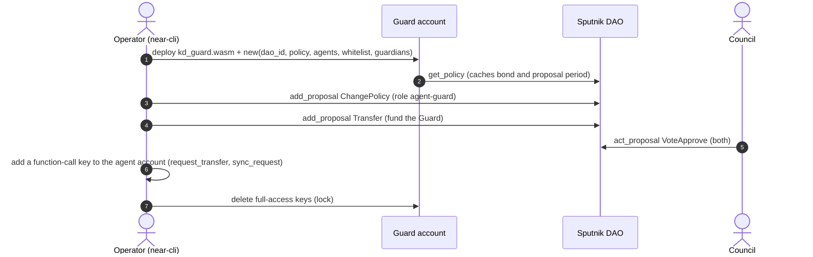
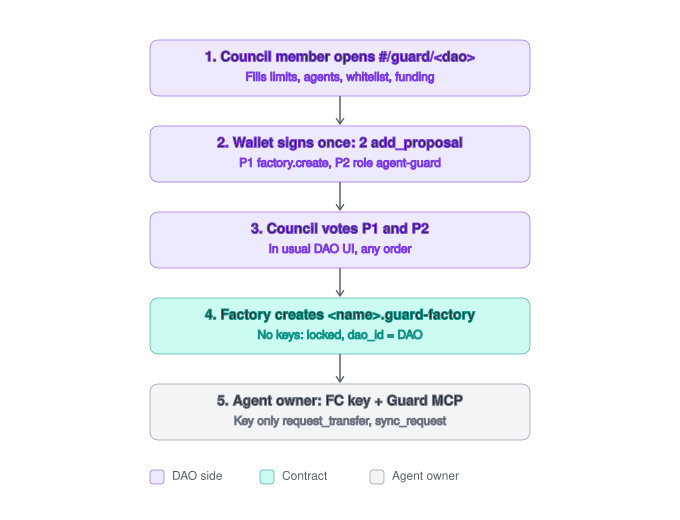
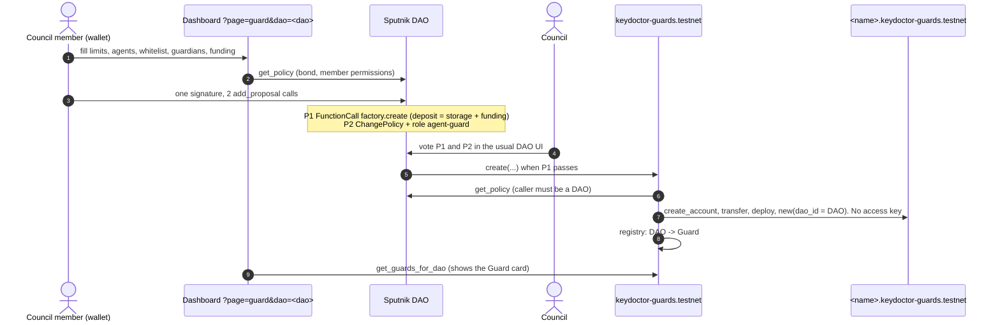
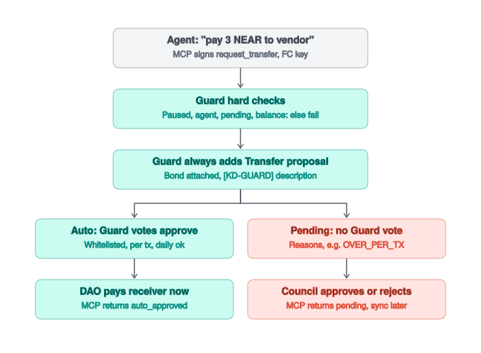
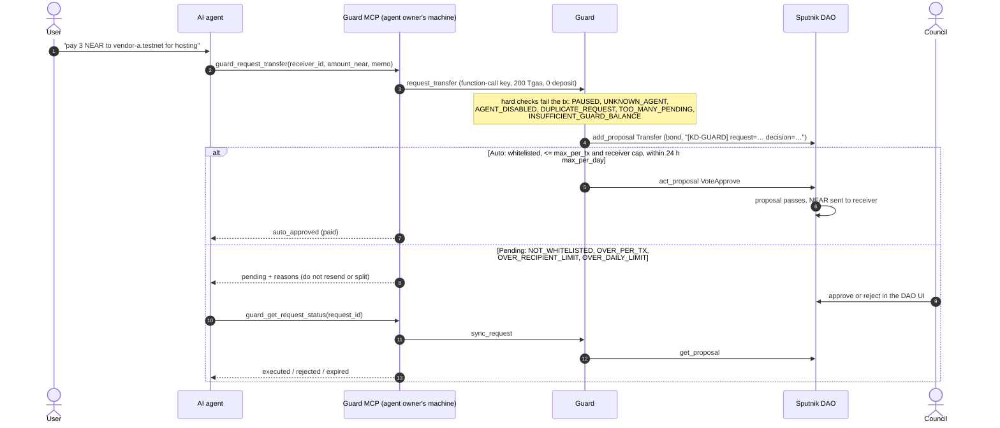

# Agent Guard: end-to-end flow

How a DAO gets an Agent Guard and how an AI agent then spends DAO money through it. Testnet names throughout. Contract: `contracts/guard`. Agent side: `apps/guard-mcp`. Step-by-step commands: [guard-integration.md](guard-integration.md).

## Actors

| Actor | Holds | Can do |
|---|---|---|
| Council member | own wallet (Meteor, Here, HOT, near-cli) | create DAO proposals, vote |
| DAO (Sputnik v2) | the treasury | pays only through passed proposals |
| Guard contract | no keys after setup (locked) | add `Transfer` proposals; vote approve only within limits |
| Agent owner | the agent's function-call key | run the Guard MCP next to the agent |
| AI agent (e.g. Claude) | nothing | call the MCP tools |

## Phase 1: create the Guard

### Path A: setup script (works today)

`scripts/guard-setup/setup.sh all` runs every step for a demo DAO; `guard-integration.md` steps 1–5 do the same by hand on your own DAO.

### Path B: dashboard + Guard factory (factory on testnet)

Code, unit, render and sandbox tests are done (`contracts/guard-factory`, dashboard `?page=guard`). Factory deployed on testnet as `keydoctor-guards.testnet` (2026-11-03); no Guard created through it yet. `scripts/guard-setup/setup.sh factory` deploys your own.

What makes it safe:
- `dao_id` is the caller of `create`, so only the DAO itself can register a Guard for itself.
- The Guard is born without access keys: nobody can redeploy or drain it.
- P2 gives the Guard only `transfer:AddProposal` and `transfer:VoteApprove`. The council sees the policy diff before signing.

## Phase 2: use the Guard

## Phase 3: run it

| Need | Who | How |
|---|---|---|
| Change limits, agents, whitelist, guardians | DAO | `FunctionCall` proposal DAO → Guard (`set_policy`, `add_whitelist`, …) |
| Emergency stop | guardian or DAO | `pause`; only the DAO can `unpause` |
| Get money back | DAO | `withdraw_excess` by proposal |
| Watch | council | Key Doctor `/watch`: proposals and new full-access keys of voters |

### Guardians

A guardian is an account the DAO trusts to hit the emergency brake, usually a council member or a monitoring bot.

- Only right: call `pause()` directly, no vote, effective in the same transaction. A guardian cannot unpause, move money or change the policy, agents or whitelist.
- Set at create (`guardians` in `factory.create`, the "guardians" field of the dashboard form), later by DAO proposal `add_guardian` / `remove_guardian`. At most 5.
- The demo (`setup.sh`) makes council member C the guardian.
- Why: a DAO proposal takes hours or days to pass. If an agent key leaks or the agent misbehaves, a guardian stops the Guard at once. Restarting needs the whole council (`unpause`), so a bad guardian can only cause downtime, not take money.
- Dashboard: the Guard card shows **Pause now (guardian)** when the Guard has guardians. The connected wallet must hold a guardian account (checked before the wallet opens) and signs `pause` on the Guard directly, no deposit. near-cli works too.

### Enable / disable

| Level | Turn off | Turn back on | Who |
|---|---|---|---|
| Whole Guard | `pause()`: every `request_transfer` fails with `PAUSED` | `unpause()` | off: guardian or DAO; on: DAO proposal only |
| One agent | `set_agent_enabled(id, false)` (fails with `AGENT_DISABLED`) or `remove_agent` | `set_agent_enabled(id, true)` | DAO proposal only |

Pausing does not touch proposals already in the DAO: the council still approves or rejects those.

### Retire a Guard (no delete)

A Guard cannot be deleted: it has no keys and no delete method, and the factory keeps its registry record. Its code storage (about 2.5 NEAR, paid by the DAO's create deposit) and state stay locked. To take one out of service, all by DAO proposal:

1. `ChangePolicy` removing the Guard from role `agent-guard`. This is the real cut-off: without the role the Guard cannot add any transfer proposal. Dashboard: **Propose retire** on the Guard card builds it (other Guards stay in the role; the role is dropped when this was its last Guard).
2. `pause`.
3. `withdraw_excess`: everything above the Guard's storage (or `min_reserve`) goes back to the DAO.

## Demo (invoice scene)

Four invoices in `demo/invoices/`, asked to the agent as "Submit every invoice in demo/invoices/ to the guard tool. The Guard and the DAO council decide what gets paid." Dry run on testnet (`kdg1793607117`, 2026-11-02): inv-001 to inv-003 `auto_approved`, inv-004 (500 NEAR to `attacker.testnet`, with a prompt injection) `pending`, then rejected by the council.
