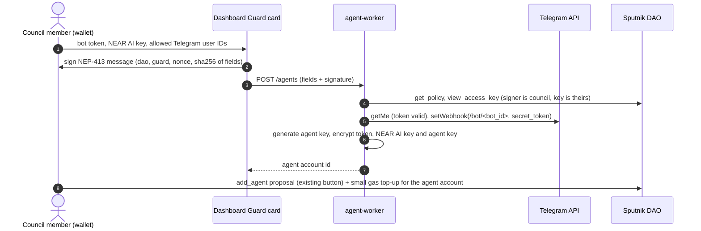

# Hosted Guard agent: one Telegram bot per DAO (plan)

Status: 2026-11-03, proposal only. Nothing is built. It breaks three invariants, so it waits for the owner decisions in §1. Recommended placement: Roadmap, after the hackathon.

Goal: Key Doctor runs the agent as a service. A DAO brings its own Telegram bot, enters a few values on the dashboard, and its council can then say "pay 3 NEAR to vendor-a.testnet for hosting" in their group. The agent (model on NEAR AI Cloud) turns that into Guard `request_transfer` calls. The Guard limits and the council vote still decide what gets paid.

## 0. Today vs this plan

| | Today | This plan |
|---|---|---|
| Telegram bot | One shared Key Doctor bot (`TELEGRAM_BOT_TOKEN` in the Worker), read-only alerts and `/check` | Plus one bot per DAO, token supplied by the DAO |
| LLM | None in the product | NEAR AI Cloud, inside the hosted agent only |
| Agent key | On the agent owner's machine (`apps/guard-mcp`, D3) | Generated and held, encrypted, by the service |
| Who calls the Guard | The DAO's own agent (Claude, any MCP client) | The hosted agent, or the DAO's own agent; both are just Guard agents |

## 1. Owner decisions (block the start)

| # | Decision | Recommendation |
|---|---|---|
| H1 | `CLAUDE.md` "No LLM in the product" | Narrow it to "No LLM in scans, rules, diffs or alerts. The hosted agent (opt-in, per DAO) calls NEAR AI to turn chat into Guard tool calls; the Guard and the council make every money decision" |
| H2 | D3/D4: "the Worker never holds a key" | Allow one key per DAO for the hosted agent only, in a separate Worker (H4), encrypted at rest. Key Doctor's Worker still holds none |
| H3 | Who pays NEAR AI | The DAO's own API key (BYOK). No shared key: no billing, no cross-DAO quota |
| H4 | Same Worker or a new one | New `apps/agent-worker` with its own D1 and secrets. A bug or leak there does not touch alerts, and Key Doctor's Worker stays keyless |

## 2. Flow



At runtime:

```
DAO group → Telegram → POST /bot/<bot_id> (secret_token check, 200 at once)
  → sender in allowed_tg_users? → decrypt keys → runAgent (NEAR AI, 3 Guard tools, max 8 steps)
  → sign request_transfer / sync_request → reply with status, reasons, request_id
```

## 3. Changes

### 3.1 Secrets at rest (envelope encryption)

What: every per-DAO secret is AES-256-GCM ciphertext in D1. The key comes from `AGENT_MASTER_KEY` (Worker secret, 32 random bytes) through HKDF with `bot_id` as salt. AAD binds each ciphertext to its row and field, so a ciphertext copied into another row fails to decrypt.

Why: D1 dumps, backups and logs must never reveal a token or key. A per-bot derived key means one row cannot be decrypted with another row's context.

```ts
async function fieldKey(master: CryptoKey, botId: string): Promise<CryptoKey> {
  return crypto.subtle.deriveKey(
    { name: "HKDF", hash: "SHA-256", salt: enc.encode(botId), info: enc.encode("kd.agent.v1") },
    master, { name: "AES-GCM", length: 256 }, false, ["encrypt", "decrypt"],
  );
}
export async function seal(master: CryptoKey, botId: string, field: Field, plain: string): Promise<string> {
  const iv = crypto.getRandomValues(new Uint8Array(12));
  const key = await fieldKey(master, botId);
  const ct = await crypto.subtle.encrypt({ name: "AES-GCM", iv, additionalData: enc.encode(`${botId}|${field}`) }, key, enc.encode(plain));
  return `v1.${b64(iv)}.${b64(ct)}`;
}
```

Rules: no API returns a secret (the dashboard shows `••••` + last 4 of the bot username only). Changing a value overwrites it. Secrets never appear in logs, error bodies or Telegram replies.

### 3.2 Registration auth (council only)

What: `POST /agents` takes a NEP-413 signed message `{dao_id, guard_id, nonce, issued_at, fields_sha256}`. The Worker checks the signature, that the public key is an access key of the signer (`view_access_key`), that the signer is in a DAO role holding `policy:AddProposal` or `*:*`, that the nonce is unused and `issued_at` is under 5 minutes old, and that `fields_sha256` matches the body.

Why: anyone can type a DAO name. Without this, a stranger could attach their bot to someone else's DAO. Putting the token on chain is not an option: chain data is public.

The real authority stays on chain: the hosted agent spends nothing until the DAO passes `add_agent` for its account.

### 3.3 One webhook per bot

What: `setWebhook(url = /bot/<bot_id>, secret_token = 32 random bytes, allowed_updates = ["message"])`. `bot_id` is random (not the DAO name). D1 keeps only the SHA-256 of the secret. Compare in constant time, like `apps/worker/src/telegram/webhook.ts`.

Why: one bot per DAO means one URL and one secret per DAO. A leaked secret affects that bot only.

### 3.4 Who may give orders

What: `allowed_tg_users` (Telegram numeric user IDs, required, 1–20). Messages from anyone else get no LLM call, only "not allowed". Group and private chats both work; the user ID is what counts.

Why: without it, anyone in the group (or anyone who finds the bot) spends up to the Guard's daily limit.

### 3.5 The agent loop on Workers

What: reuse the `runAgent` loop from the NEAR AI demo agent plan (fake-able `chat` and `callTool`, `MAX_STEPS`), with only the three Guard tools. Port the signing in `apps/guard-mcp/src/near.ts` from `node:crypto` / `Buffer` to WebCrypto `Ed25519` and `Uint8Array`, and move it to a shared package so guard-mcp and agent-worker sign the same way.

Why: guard-mcp is Node-only today (`createPrivateKey`, `readFileSync`). Two copies of transaction signing would drift.

```ts
const key = await crypto.subtle.importKey("pkcs8", concat(PKCS8_ED25519, seed), { name: "Ed25519" }, false, ["sign"]);
const sig = new Uint8Array(await crypto.subtle.sign("Ed25519", key, sha256(txBytes)));
```

### 3.6 Agent account

What: the Worker generates an Ed25519 key pair and uses its implicit account (64-hex id). The DAO funds it with about 0.5 NEAR for gas and passes `add_agent` for it.

Why: the account holds only gas money, never DAO funds. The service does not need the DAO's keys or any existing account's key. Trade-off: the implicit account's key is full access on that account, so a leak loses at most its gas balance plus whatever the Guard lets through (§4).

### 3.7 Limits and removal

- Rate limit per bot (D1 counter): 30 messages per hour, 10 tool calls per hour.
- `POST /agents/<bot_id>/disable` (council-signed like §3.2): `deleteWebhook`, wipe the ciphertexts.
- On-chain cut-off, which works even if the service is down: `remove_agent` or `set_agent_enabled(false)` by proposal, or a guardian `pause`.

### 3.8 D1 schema (agent-worker)

```sql
CREATE TABLE agent_bots (
  bot_id TEXT PRIMARY KEY,            -- random, used in the webhook path
  dao_id TEXT NOT NULL,
  guard_id TEXT NOT NULL,
  agent_account_id TEXT NOT NULL,     -- implicit account of the generated key
  tg_bot_username TEXT NOT NULL,
  webhook_secret_sha256 TEXT NOT NULL,
  enc_tg_token TEXT NOT NULL,
  enc_nearai_key TEXT NOT NULL,
  enc_agent_key TEXT NOT NULL,
  key_version INTEGER NOT NULL,       -- master key rotation
  allowed_tg_users TEXT NOT NULL,     -- JSON array of numeric IDs
  created_by TEXT NOT NULL,           -- council account that signed
  created_at TEXT NOT NULL,
  disabled_at TEXT
);
CREATE TABLE agent_audit (           -- no message text, no secrets
  id INTEGER PRIMARY KEY, bot_id TEXT NOT NULL, tg_user_id TEXT NOT NULL,
  tool TEXT NOT NULL, request_id TEXT, status TEXT NOT NULL, at TEXT NOT NULL
);
CREATE TABLE used_nonces (nonce TEXT PRIMARY KEY, at TEXT NOT NULL);
```

## 4. Threats

| Threat | Effect | Bound |
|---|---|---|
| `AGENT_MASTER_KEY` leaks with a D1 dump | Every hosted agent key and bot token | Guard caps per DAO (`max_per_tx`, `max_per_day`, whitelist, council vote on the rest); guardians pause; rotate via `key_version` |
| Allowed user's Telegram account taken over | Requests up to the Guard limits | Same caps; `agent_audit` shows who asked |
| Prompt injection in a chat message or invoice | Agent requests an odd transfer | Off-whitelist or over-limit goes `pending`; council rejects (demo inv-004) |
| Stranger registers a bot for someone else's DAO | Nothing spent: no `add_agent` | §3.2 council signature; on-chain `add_agent` |
| Webhook secret guessed | Fake updates | 32 random bytes, constant-time compare, allowlist still applies |
| NEAR AI down or slow | No new requests | Reply "agent unavailable"; DAO's own MCP agent still works |

## 5. Phases (about 4 days)

| Phase | Work | Done when |
|---|---|---|
| H0 | Owner decisions H1–H4, `CLAUDE.md` invariants updated | Decisions recorded here |
| H1 | Shared signing package (WebCrypto Ed25519), guard-mcp switched to it | guard-mcp 42 tests still pass; signature matches a near-cli fixture |
| H2 | `apps/agent-worker`: D1 schema, `seal`/`open`, `POST /agents` with NEP-413 auth, `setWebhook` | Tests: wrong signer, non-council, replayed nonce, stale `issued_at`, swapped ciphertext all refused |
| H3 | `POST /bot/<bot_id>`, allowlist, `runAgent` with NEAR AI, rate limit, audit | Tests with fake Telegram and fake NEAR AI: tool result fed back, `MAX_STEPS`, non-allowed user gets no LLM call, no secret in any reply or log |
| H4 | Dashboard "Hosted agent" form on the Guard card, disable button | Render tests; testnet run: 3 invoices `auto_approved`, inv-004 `pending` |
| H5 | README section + Limitations (LLM in hosted agent only, service holds keys, Guard caps the loss) | README steps reproduce the testnet run |

## 6. Out of scope

- TEE signing (NEAR AI private inference or a Shade Agent with chain signatures) so the key never leaves an enclave. This is the long-term fix for the master-key threat.
- Pause and admin methods from chat: the agent key cannot call them, by design.
- Mainnet.
