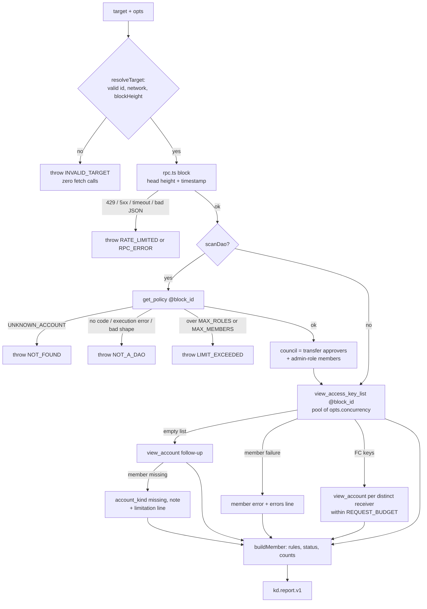

# High-Risk Story: GĐ1 scan library (`scanAccount`, `scanDao`, rules, RPC client) — Overview

The full flow, with every error edge, is `docs/design/gd1-scan.md` §1. The §3 tables of that design win over both diagrams.

- **Status**: in progress (S1 to S3 built; S4 planned)
- **Lane**: high-risk (`docs/FEATURE_INTAKE.md`)
- **Risk factors**: `packages/key-doctor/src/rpc.ts` is a `high_risk` path in `.claude/dev-team.md`. It fetches user-supplied targets. Every later phase (GĐ3 Worker, GĐ4 bot, GĐ10 dashboard) consumes its report. Error text can leak an RPC URL that holds a provider API key.

## Governing entry

- `docs/final-idea.md` §13.3, GĐ1 row (`docs/final-idea.md:874`): `rpc.ts`, `scanAccount`, `scanDao`, the §5.1 rules, `messages`.
- Rules: `docs/final-idea.md` §5.1 (`:523-539`). Contracts: §4 (`kd.report.v1`, `kd.error.v1`), already code in `packages/key-doctor/src/types.ts`.
- The GĐ1 "Xong khi" text at `docs/final-idea.md:874` is out of date. Decision 0001 replaces it. The spec file is human-authored, so this packet does not edit it.

## Problem Statement

Every Key Doctor surface (bot, MCP, dashboard, daily diff) needs one scan library. It reads a NEAR account or a Sputnik DAO council at one block and returns a `kd.report.v1`. No scan code exists yet. The library is high-risk because it calls RPC with user-supplied ids, and its error text and caps protect the Worker that runs it.

## Proposed Solution

A pure TypeScript library under `packages/key-doctor/src/` that uses only `fetch`. `rpc.ts` is the only `fetch` caller. It pins every query after `block` to one `block_id`. `scanAccount` and `scanDao` check the target before any request, read keys through a bounded pool, and run the 13 rules of §5.1. Each member goes through one pure `buildMember()` function.

Errors map to the closed `kd.error.v1` code set with fixed vi and en text. A per-member failure goes into `members[].error` and never fails the whole scan. Caps and a per-scan request budget bound the work.

A live-run script, `packages/key-doctor/scripts/scan.ts`, lets the owner check the recalled RPC and Sputnik facts on testnet.

## Decisions

Recorded in `docs/decisions/0001-gd1-done-when.md` and `docs/decisions/0002-gd1-rule-set-reading.md`.

| Decision | Decider |
|---|---|
| GĐ1 done-when: a fixture corpus (one positive and one negative case per rule) plus one live testnet scan replace "scan the 20 prototype accounts" | owner, 2026-10-29 |
| All 3 T5 rules ship. `FA_BOT_LIKE` fires at 1000 uses. | owner, 2026-10-29 |
| `DAO_ADMIN` is a member who can pass a policy proposal alone | owner, 2026-10-29 |
| Key age uses a constant 1.2 s block time | owner, 2026-10-29 |
| A missing council member is `note` with a limitation line | owner, 2026-10-29 |
| A council of 22 or more throws `LIMIT_EXCEEDED`. A partial scan goes to the Roadmap. | owner, 2026-10-29 |
| No per-member callback in GĐ1. The `buildMember()` seam stays instead. | orchestrator, on the red-team's side |
| `members_ok` counts `ok` plus `note` (`docs/final-idea.md:311`) | orchestrator |
| `FA_MANY` suppresses `FA_MULTIPLE`. `MAX_ROLES` is 50. `MAX_KEYS` is 100. | Lead Dev design, decider unchecked for the owner |

## Scope

### In Scope
- `rpc.ts`, `errors.ts`, `parse.ts`, `age.ts`, `messages.ts`, `rules/*`, `scan.ts` and the `index.ts` value exports.
- The 13 rules of §5.1, with thresholds and caps in `rules/thresholds.ts`.
- New and updated fixtures, and a rule corpus under `packages/key-doctor/fixtures/corpus/`.
- The live-run script `packages/key-doctor/scripts/scan.ts`.

### Out of Scope
- `diffReports` and `toSummary` (GĐ2).
- `checkProposals` (GĐ5).
- A per-member callback or progress events (later, through `buildMember()`).
- A partial scan of a council larger than 21 (Roadmap).
- Retries. No path retries.
- Any change to `packages/key-doctor/src/types.ts`.

### Success Criteria
- **Built**: S1 to S4 meet their ACs below.
- **Done**: built, and the owner recorded the `docs/design/gd1-scan.md` §11 live-run checklist in `packages/key-doctor/fixtures/README.md`, with the testnet DAO name and block height. Until then the status word is "built", not "done".

## Acceptance Criteria

**S1**
- S1-AC1: `scanAccount("b.kd-demo.testnet")` on `block.json` and `view_access_key_list.b.json` returns `kd.report.v1`, `target.type: "account"`, `chain.block_height: 182340111`, one member. Every query after `block` carries `block_id: 182340111`.
- S1-AC2: `FA_MANY`, `FA_MULTIPLE` (suppressed by `FA_MANY`), `PQ_PARTIAL`, `PQ_NONE`, `FA_OLD`, `KEY_UNUSED`, `FA_BOT_LIKE` per section 6, over one account's keys.
- S1-AC3: age per section 5. A height below `GENESIS_HEIGHT[network]` or above the head gives `source: "unknown"` and, on an FA key, `FA_OLD`.
- S1-AC4: an invalid id, a `0x` id, a suffix conflicting with `opts.network`, or a bad `blockHeight` throws `INVALID_TARGET` with zero `fetch` calls. `resolveTarget` is exported per section 8.
- S1-AC5: errors map per section 3, including the 15 s timeout, the empty-list follow-up and `MAX_KEYS`. `isKdError` is true on each throw. Message, `kd.message` and `cause` (unset) hold no URL and no body text.
- S1-AC6: `summary` and `counts` per section 7 for one member, `council_size: 0`.
- S1-AC7: `report.ruleset_version === RULESET_VERSION`. Every threshold and cap is a named export of `thresholds.ts`; rule and scan files hold no literal for one. Only `rpc.ts` references `fetch`, read from `globalThis` at call time when no `fetchImpl` is given. No file under `src/` imports `node:*`.
- S1-AC8: `node packages/key-doctor/scripts/scan.ts <id> [--dao] [--network testnet] [--block N] [--save-raw <dir>]` (Node 22 strip-types) prints the report. `--save-raw` wraps `globalThis.fetch` and writes each raw response body to `<dir>/<n>.<method>.json`, never the URL, and is refused when `resolveTarget` returns `network: "mainnet"` (so `scan foo.near --save-raw d` is refused through the suffix, with no `--network` flag).

**S2**
- S2-AC1: `FC_UNLIMITED_ALLOWANCE`, `FC_ANY_METHOD`, `FC_DEAD_RECEIVER` per section 6, over one account's FC keys.
- S2-AC2: receivers per section 3: each distinct receiver checked once; `false` / `null` + `errors[]` line / `null` + one limitation line, no request; FA keys carry no `receiver_exists`.
- S2-AC3: `scanAccount("b.kd-demo.testnet")` deep-equals `account-b.report.json` except `generated_at`.

**S3**
- S3-AC1: `scanDao("kd-demo.sputnik-dao.testnet")` deep-equals the updated `dao-kd-demo.report.json` except `generated_at`. Every query after `block`, including `get_policy`, key lists and receivers, carries the same `block_id`.
- S3-AC2: council, `dao.roles`, `transfer_vote_policy`, `approvals_needed` and the limitation lines per section 4, over one DAO's policy roles.
- S3-AC3: `DAO_ADMIN`, `FC_DAO_VOTE`, `COUNCIL_SMALL` per section 6. `FC_DAO_VOTE` runs over council members' FC keys whose receiver is the scanned DAO.
- S3-AC4: member failures, missing members, `errors[]` order, sort and counts per sections 3 and 7, including all members errored (`members_scanned: 0`, `note`). The scan still returns a report.
- S3-AC5: `get_policy` errors per section 3 (`CONTRACT_EXECUTION_ERROR`, `result.error` → `NOT_A_DAO`; an unknown cause such as `GARBAGE_COLLECTED_BLOCK` → `RPC_ERROR`, not retryable). Caps per section 9 before any key-list read. At most 4 requests in flight at default concurrency; at most 45 requests per scan, also with 21 members that all have empty key lists.
- S3-AC6: every one of the 13 rule ids, every member error code and every `kd.error.v1` code gives non-empty `vi` and `en` text from `evidence` or the code only. No member-error text implies low risk. `LIMIT_EXCEEDED` text names the cap.

**S4**
- S4-AC1: each of the 13 rules has one positive and one negative case; the rule's presence in the report equals `fires`. Negatives sit just under the threshold: 4 Ed25519 FA keys (`FA_MANY`), 1 (`FA_MULTIPLE`), 730 days (`FA_OLD`), 999 uses (`FA_BOT_LIKE`), 3 members (`COUNCIL_SMALL`), 2 votes needed (`DAO_ADMIN`), a DAO FC key limited to `add_proposal` (`FC_DAO_VOTE`).
- S4-AC2: `LIMIT_NON_GROUP_ADMIN.json`: an `Everyone` role matching `policy:VoteApprove` gives the section 4 "policy changes" line and no `DAO_ADMIN`.
- S4-AC3: `fixtures/README.md` lists the corpus and the section 11 checklist. Every item starts `unconfirmed`; only the owner's run sets `confirmed` or `differs: <value>`, with the account or DAO name and block height.

"Section N" in the ACs means `docs/design/gd1-scan.md` section N. The AC text is copied word for word from that design, §10.

## Stakeholders

- **Decision maker**: the owner (product rules), the Lead Dev (design).
- **Implementer**: one builder per slice, in the order S1, S2, S3, S4.
- **Reviewer**: the Lead Dev.
- **Affected**: GĐ2 (`diffReports` reads the report), GĐ3 Worker and MCP, GĐ4 bot, GĐ10 dashboard.

## Risks

| Risk | Likelihood | Impact | Mitigation |
|---|---|---|---|
| Recalled RPC cause names, genesis heights or Sputnik `policy.rs` rules are wrong | med | high | The owner's live run checks each item of design §11. GĐ1 stays "built" until it is recorded. |
| Error text leaks an RPC URL with an API key, or RPC body text | low | high | Fixed text per code. `KdErrorException` never sets `cause` (design §9). |
| A large council or key list exhausts the Workers subrequest cap | med | med | `MAX_MEMBERS` 21, `MAX_KEYS` 100, `MAX_ROLES` 50, `REQUEST_BUDGET` 45 per scan (design §9). |
| A worst-case scan (300 s at concurrency 4) exceeds the `waitUntil` window in GĐ4 | med | med | GĐ4 measures it (design §9 item 7). |
| The Worker passes user input into `opts.rpcUrl` (server-side request forgery) | low | high | Design §9 item 3. GĐ3 and GĐ4 callers carry the note. |
