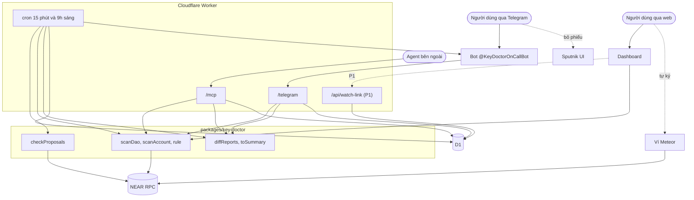
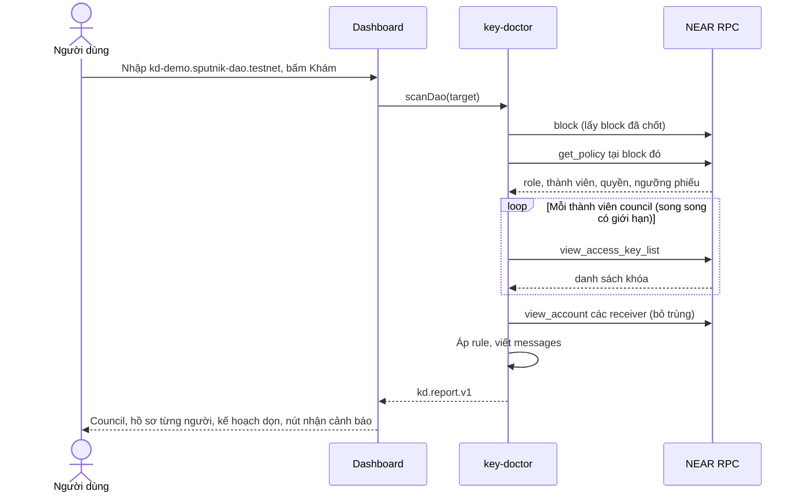
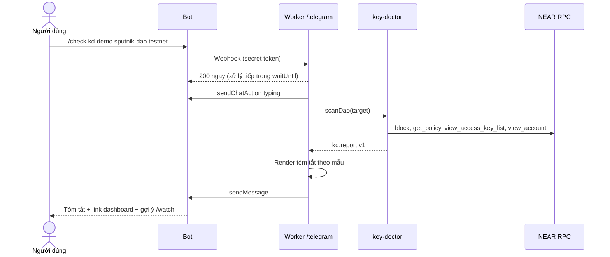
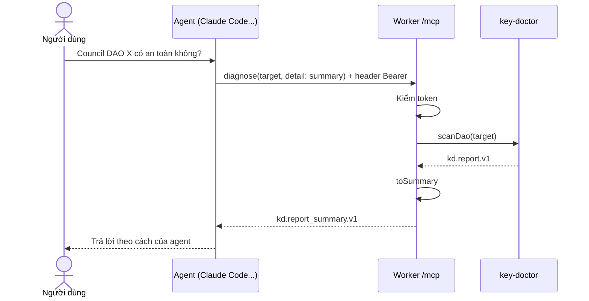
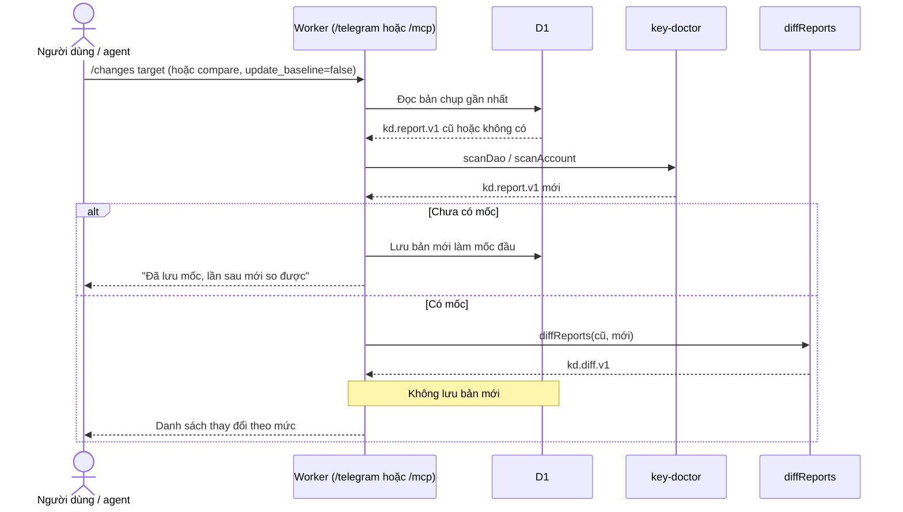
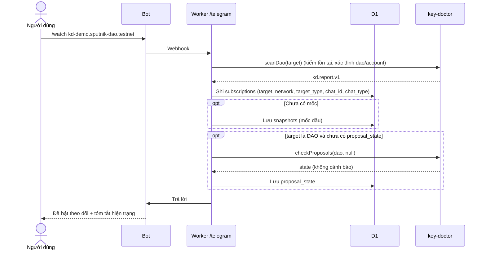
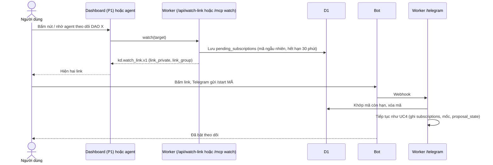
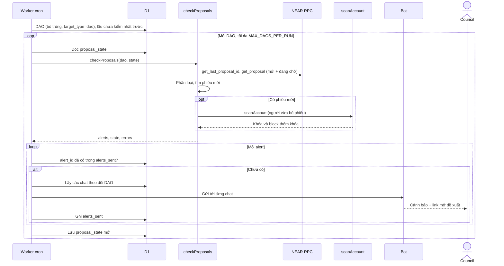
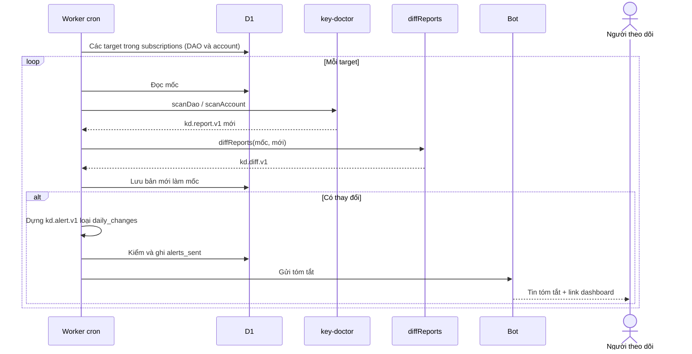
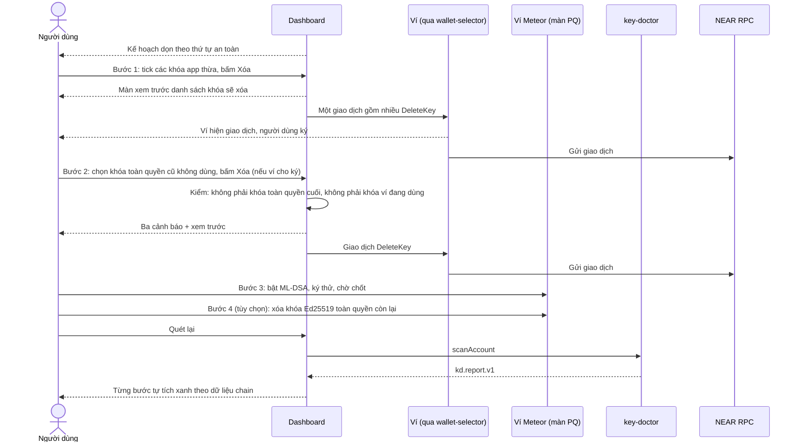

# Key Doctor: các use case và luồng hoạt động

| | |
|---|---|
| Phiên bản | 2026-10-29 |
| Đọc kèm | `final-idea.md` (hướng đi, hợp đồng dữ liệu, mức ưu tiên, thứ tự build), `proposal-key-doctor.md` (lõi Key Doctor, bản v2) |
| Sản phẩm | **Key Doctor**; tính năng canh quỹ **On Call** (UC4 đến UC7) |
| Cách đọc | Mỗi use case ghi **Mức** (P0 / P1) và **Giai đoạn** (GĐ, theo mục 13.3 của `final-idea.md`). Không chia việc theo người; Claude Code build theo thứ tự giai đoạn |

Tài liệu mô tả **8 use case**: ai kích hoạt, các thành phần gọi nhau theo thứ tự nào, dữ liệu gì đi qua, xử lý ngoại lệ, và thế nào là xong. Sơ đồ viết bằng Mermaid. Định dạng dữ liệu (`kd.report.v1`, `kd.diff.v1`, `kd.alert.v1`...) định nghĩa ở mục 4 của `final-idea.md`.

---

## 0. Tổng quan

### 0.1 Thành phần

| Thành phần | Là gì | Giai đoạn |
|---|---|---|
| Người dùng | Thành viên council DAO hoặc cá nhân giữ account NEAR | |
| Dashboard | Trang web trên Cloudflare Pages, quét chạy trong trình duyệt | GĐ7, GĐ8 |
| `key-doctor` | Thư viện TypeScript: `scanDao`, `scanAccount`, bộ rule, `checkProposals` | GĐ1, GĐ5 |
| `diffReports`, `toSummary` | Hàm thuần trong thư viện `key-doctor` | GĐ2 |
| Worker | Cloudflare Worker: `/telegram`, `/mcp`, `/api/watch-link`, `/run-check`, cron | GĐ3, GĐ4, GĐ6, GĐ9 |
| D1 | Cơ sở dữ liệu của Worker | GĐ3 trở đi |
| Bot `@KeyDoctorOnCallBot` | Bot Telegram, do Worker điều khiển | GĐ4 |
| Agent bên ngoài | Claude Code, OpenClaw... cắm vào `/mcp` | Không xây |
| NEAR RPC | Nguồn dữ liệu, chỉ đọc | Có sẵn |
| Ví (qua wallet-selector), Meteor | Người dùng ký giao dịch xóa khóa; bật ML-DSA trong Meteor | Có sẵn |
| Sputnik UI | Council bỏ phiếu | Có sẵn |

### 0.2 Sơ đồ tổng thể

### 0.3 Bốn nhóm use case

| Nhóm | Use case | Ai bắt đầu |
|---|---|---|
| Tra cứu | UC1 Khám qua web, UC2 Kiểm tra qua bot hoặc agent, UC3 Xem thay đổi | Người dùng |
| Đăng ký (On Call) | UC4 Đăng ký qua bot, UC5 Đăng ký qua dashboard hoặc agent | Người dùng |
| Tự động canh (On Call) | UC6 Canh đề xuất, UC7 So khóa hằng ngày | Worker cron |
| Hành động | UC8 Dọn khóa | Người dùng |

### 0.4 Nguyên tắc xuyên suốt

1. **Không giữ khóa, không ký giao dịch thay người dùng.** Mọi dữ liệu đọc từ RPC công khai. Khi dọn khóa, dashboard chỉ dựng giao dịch; người dùng ký bằng ví.
2. **Code quyết định mọi kết luận.** Không dùng LLM trong sản phẩm.
3. **Chỉ job UC7 và lần đăng ký đầu được ghi mốc so sánh.**
4. **Một nguồn duy nhất cho đăng ký:** bảng `subscriptions`, chỉ Worker ghi.
5. **Bot là kênh báo động duy nhất.**

### 0.5 Dữ liệu trong D1

| Bảng | Mô tả | Dùng ở |
|---|---|---|
| `snapshots` | Bản chụp `kd.report.v1` theo thời gian | UC3, UC4, UC7 |
| `subscriptions` | target → chat Telegram, kèm `target_type` | UC4 đến UC7 |
| `pending_subscriptions` | Mã chờ xác nhận từ link | UC5 |
| `proposal_state` | `ProposalWatchState` của từng DAO | UC4, UC6 |
| `alerts_sent` | Cảnh báo đã gửi, chống trùng | UC6, UC7 |

Schema đầy đủ: mục 8.7 của `final-idea.md`.

---

## UC1. Khám qua web

**Mục đích:** xem sức khỏe khóa của một DAO hoặc account, không cần đăng nhập.
**Kích hoạt:** người dùng mở dashboard, nhập tên, bấm Khám.
**Mức:** P0. **Giai đoạn:** GĐ1 (thư viện), GĐ7 (dashboard).

### Các bước

1. **Nhận diện:** thử `get_policy`; trả về được là DAO, lỗi thì xử lý như account. Đuôi tên quyết định mạng. Báo lỗi lời thường nếu sai định dạng hoặc không tồn tại.
2. **Chốt thời điểm:** lấy block đã chốt, mọi truy vấn sau dùng đúng block này.
3. **Đọc council** (DAO): thành viên các role có quyền duyệt chuyển tiền, Admin, ngưỡng phiếu.
4. **Đọc khóa từng người:** loại khóa từ tiền tố public key; quyền; nonce ra block thêm khóa và số lần dùng. Khóa trước khoảng giữa 2021 ghi "không rõ tuổi".
5. **Kiểm receiver** của khóa hạn chế (bỏ trùng); được bỏ qua khi sát giới hạn, ghi `limitations`.
6. **Áp rule**, ra `kd.report.v1`. Mức người = mức cao nhất trong các cờ; mức DAO = mức người yếu nhất.
7. **Hiển thị** bốn màn theo v2, cộng nút "Nhận cảnh báo qua Telegram" (UC5).

### Quyết định kỹ thuật

- Quét trong trình duyệt; song song khoảng 4 truy vấn; hiện dần từng thành viên.
- Lỗi từng người ghi `members[].error`, dòng đó hiện "không đọc được, thử lại".
- "Ngồi trong council của bao nhiêu DAO" cần chỉ mục toàn mạng (#16, P2).
- Không có danh sách gợi ý DAO thật; ví dụ dùng testnet.

### Xong khi

- DAO mẫu cho báo cáo trong vài giây, sắp theo rủi ro.
- Mỗi khóa có đúng một câu lý do.
- Cùng target, cùng block: kết quả trùng với `/check` (UC2) và `diagnose`.

---

## UC2. Kiểm tra qua bot hoặc agent

**Mục đích:** kiểm tra nhanh mà không mở web.
**Kích hoạt:** (a) người dùng gõ `/check <target>` hoặc một câu có tên account/DAO trong bot; (b) agent bên ngoài gọi tool `diagnose`.
**Mức:** P0. **Giai đoạn:** GĐ3 (`diagnose`), GĐ4 (`/check`).

### (a) Qua bot

Các bước:

1. Kiểm secret token của webhook; sai thì bỏ.
2. Tách lệnh. **Tin nhắn không phải lệnh:** tìm tên dạng `*.near` / `*.testnet` bằng regex; tìm được một tên thì chạy như `/check`, không thì trả `/help`.
3. Trả `200` ngay, phần quét chạy trong `ctx.waitUntil`, gửi trạng thái "đang soạn tin".
4. Gọi `scanDao` hoặc `scanAccount`.
5. Render tóm tắt theo mẫu 9.2 của `final-idea.md`: trạng thái, số người theo mức, vài cờ `high` đầu tiên, link dashboard, gợi ý `/watch`.
6. **Không đọc, không ghi D1.**

### (b) Qua agent bên ngoài (MCP)

`detail: "full"` trả nguyên `kd.report.v1`. Không đụng D1.

### Xong khi

- `/check` trên DAO mẫu trả tóm tắt trong vài giây.
- Câu "kiểm tra giúp kd-demo.sputnik-dao.testnet" cũng chạy như `/check`.
- `diagnose` qua Claude Code và `/check` cho cùng kết luận với dashboard.

---

## UC3. Xem thay đổi

**Mục đích:** xem khóa thay đổi gì so với lần kiểm tra định kỳ gần nhất, không làm hỏng việc canh tự động.
**Kích hoạt:** `/changes <target>` trong bot, hoặc tool `compare` qua MCP.
**Mức:** P0. **Giai đoạn:** GĐ2 (`diffReports`), GĐ3 (`compare`), GĐ4 (`/changes`).

### Quy tắc

- `/changes` luôn không dời mốc. `compare` qua MCP mặc định `update_baseline: false`.
- Thành viên có lỗi ở một trong hai báo cáo: bỏ qua khi so, ghi `limitations`.
- Khác `ruleset_version`: so khóa và thành viên, bỏ qua thay đổi về cờ.

### Xong khi

- Gọi hai lần liên tiếp cho cùng kết quả (mốc không bị dời).

---

## UC4. Đăng ký qua bot

**Mục đích:** bật nhận cảnh báo cho một DAO hoặc account.
**Kích hoạt:** `/watch <target>` trong DM hoặc nhóm council.
**Mức:** P0. **Giai đoạn:** GĐ4 (phần `proposal_state` hoàn thiện ở GĐ6).

### Lệnh

| Lệnh | Việc |
|---|---|
| `/watch <target>` | Bật theo dõi cho chat này |
| `/unwatch <target>` | Tắt |
| `/list` | Liệt kê target của chat |

### Ghi chú

- Ai cũng `/watch` được bất kỳ target nào (dữ liệu công khai).
- Cảnh báo chỉ đến được chat đã đăng ký; không có cách nhắn vào một ví NEAR.
- `checkProposals(dao, null)` đảm bảo chỉ báo đề xuất **từ lúc đăng ký trở đi**.

### Xong khi

- `/watch` trong nhóm nhận xác nhận; `/list` hiện target; `/unwatch` xóa được.
- Đăng ký cùng target hai lần trong cùng chat chỉ có một dòng.

---

## UC5. Đăng ký qua dashboard hoặc agent bên ngoài

**Mục đích:** bật cảnh báo từ dashboard hoặc từ agent, mà dữ liệu vẫn chỉ nằm ở một chỗ.
**Kích hoạt:** nút "Nhận cảnh báo qua Telegram" trên dashboard, hoặc agent gọi tool `watch`.
**Mức:** P0 cho bản MVP (GĐ7); P1 cho link xác nhận, tool `watch`, `/api/watch-link` (GĐ12).

**Vì sao phải đi qua bot:** dòng đăng ký cần `chat_id`, mà chỉ Telegram cung cấp khi người dùng nhắn hoặc bấm Start với bot. Dashboard cũng không truy cập được D1. Nên dashboard và agent chỉ **đưa người dùng sang bot**; Worker ghi đăng ký.

### Dashboard, bản MVP

Nút mở hộp hướng dẫn: lệnh `/watch <target>` có nút sao chép, nút mở bot, hướng dẫn thêm bot vào nhóm council. Người dùng gửi lệnh trong bot → đi tiếp như UC4. Dashboard không gọi Worker.

### Dashboard bản P1, hoặc agent bên ngoài

### Ngoại lệ

- Mã hết hạn hoặc không tồn tại: "Link đã hết hạn, tạo lại trên dashboard hoặc nhờ agent".
- `/api/watch-link` chỉ nhận request từ `DASHBOARD_ORIGIN`.
- Dashboard không hiển thị trạng thái "đang theo dõi"; xem và hủy trong bot.

### Xong khi

- MVP: từ dashboard sao chép lệnh, gửi trong bot, nhận xác nhận.
- P1 / agent: bấm link, nhận xác nhận; `/list` hiện target.

---

## UC6. Canh đề xuất (mỗi 15 phút)

**Mục đích:** phát hiện rủi ro **trước khi** tiền của quỹ đi hoặc luật DAO bị đổi. Use case tạo giá trị chính.
**Kích hoạt:** cron mỗi 15 phút; khi demo gọi `/run-check`.
**Mức:** P0. **Giai đoạn:** GĐ5 (`checkProposals`), GĐ6 (job điều phối, gửi tin, lưu trạng thái, script demo). Mốc bắt buộc: chạy trọn trên testnet trước 8/11.

### Trong thư viện: `checkProposals(dao, prev)` (GĐ5)

1. `prev = null`: ghi nhận đề xuất cuối, **không cảnh báo**.
2. Đọc đề xuất mới (id lớn hơn `last_proposal_id`) và đề xuất trong `prev.pending`.
3. Phân loại:

| Nhãn loại Sputnik | Nhóm |
|---|---|
| `transfer`, `call` | Chi tiền / hành động |
| `add_member_to_role`, `remove_member_from_role`, `policy`, `policy_*`, `config` | Thay đổi quyền → cảnh báo `governance_change_proposal` ngay khi xuất hiện |
| `upgrade_self`, `upgrade_remote` | Thay đổi code → cảnh báo `code_upgrade_proposal` |
| Còn lại | Bỏ qua |

4. Tìm phiếu mới so với `votes_seen`. Sputnik không lưu thời điểm bỏ phiếu; sai số tối đa bằng chu kỳ cron.
5. Với người có phiếu mới: `scanAccount`, xem có khóa **full-access** với `created.block_height` trong 48 giờ gần đây → cảnh báo `voter_new_full_access_key`.
6. Tính `approvals_have`, `approvals_needed`, `pending_voters` từ policy. Đã thực thi (DAO 1 phiếu) → `after_the_fact: true`.
7. Viết `messages` tiếng Việt và tiếng Anh; sinh `alert_id`.
8. Bỏ đề xuất đã kết thúc khỏi `pending` trong `state` trả về.
9. Chỉ đọc RPC; không lưu, không gửi.

### Trong Worker: job điều phối (GĐ6)

- **Quét theo DAO**, không theo lượt đăng ký.
- `checkProposals` throw → không lưu state, lần sau thử lại.
- **Gửi trước, ghi `alerts_sent` sau** (gửi trùng một lần còn hơn bỏ sót).
- Telegram báo bot bị chặn / bị đá khỏi nhóm → xóa đăng ký của chat đó.
- Render tin theo mẫu 9.1 của `final-idea.md`: tên người chưa bỏ phiếu, khuyên xác minh qua kênh khác, link mở đề xuất.

### Giới hạn

- DAO 1 phiếu: chỉ báo được sau sự việc.
- Độ trễ tối đa bằng chu kỳ cron (mặc định 15 phút).
- Nhiều DAO: mỗi lần chạy xử lý một phần; chỉ quét khóa người vừa bỏ phiếu.

### Kịch bản demo testnet (GĐ6)

1. Dựng DAO cần 2 phiếu cho đề xuất chuyển tiền, 3 thành viên.
2. Thêm bot vào nhóm Telegram, `/watch` DAO.
3. Tạo đề xuất chuyển tiền.
4. Thêm khóa full-access mới vào account thành viên A, rồi A bỏ phiếu duyệt.
5. `/run-check`: nhóm nhận cảnh báo nêu tên người chưa bỏ phiếu.
6. Tạo đề xuất `add_member_to_role`, `/run-check`: nhận cảnh báo thay đổi quyền.

### Xong khi

- Kịch bản demo chạy trọn, cảnh báo đến trước phiếu thứ hai.
- Đề xuất thay đổi quyền sinh cảnh báo mức cao.
- Hai lần chạy liên tiếp không có gì mới thì không gửi trùng.
- `checkProposals` có test với fixture `get_proposal`.

---

## UC7. So khóa hằng ngày

**Mục đích:** theo dõi dài hạn khóa council: khóa mới, khóa bị xóa, thành viên mới, tiến độ dọn.
**Kích hoạt:** cron 2:00 UTC (9:00 giờ Việt Nam).
**Mức:** P0. **Giai đoạn:** GĐ9. Nếu trễ, cắt sau GĐ11, GĐ13, GĐ12 (xem mục 13.4 của `final-idea.md`).

### Xong khi

- Thêm một khóa vào account test, lần chạy sau nhận tin "khóa mới".
- Xóa khóa đó, lần chạy sau nhận tin "khóa đã xóa, cờ hết".
- Không có thay đổi thì không gửi.

---

## UC8. Dọn khóa

**Mục đích:** đưa account về trạng thái xanh, an toàn, không tự khóa mình ra ngoài.
**Kích hoạt:** người dùng mở kế hoạch dọn trên dashboard.
**Mức:** P0. **Giai đoạn:** GĐ8.

**Nguyên tắc:** Key Doctor không giữ khóa và không ký. Dashboard **dựng giao dịch xóa khóa**, người dùng **ký bằng ví** (kết nối qua wallet-selector). Riêng bước thêm khóa ML-DSA phải làm trong Meteor, vì wallet-selector không hỗ trợ ML-DSA và dApp không yêu cầu Meteor thêm khóa chống lượng tử được.

### Thứ tự dọn

| Bước | Việc | Làm ở đâu | Rủi ro nếu sai |
|---|---|---|---|
| 1 | Xóa khóa app thừa: chưa dùng, trỏ contract chết, quyền quá rộng. **Nhiều khóa trong một lần ký** | **Dashboard**, ví ký | Thấp: tệ nhất phải đăng nhập lại app |
| 2 | Xóa khóa Ed25519 toàn quyền **chưa từng dùng hoặc cũ**, giữ lại khóa ví đang dùng | **Dashboard** nếu ví cho ký; không thì Meteor | Cao |
| 3 | Thêm ML-DSA (màn PQ; account cần có NEAR trả phí), ký thử, chờ chốt | **Meteor** | Bỏ ký thử là nguy hiểm |
| 4 | (Mức "chuyển hẳn") Xóa khóa Ed25519 toàn quyền còn lại | **Meteor** (lúc này ví ký bằng ML-DSA, dashboard không nhờ ký qua wallet-selector được) | **Cao** |
| 5 | Quét lại | Dashboard | |

Bước 1 và 2 làm **trước** khi bật ML-DSA, vì sau khi ví chuyển sang ký bằng ML-DSA, dashboard không gửi giao dịch nhờ ký được nữa.

### Quy tắc an toàn (dashboard bắt buộc kiểm)

1. **Không bao giờ dựng giao dịch xóa khóa toàn quyền cuối cùng** của account.
2. **Không xóa khóa ví đang dùng để ký** (nếu ví cho biết public key đang dùng). Nếu không xác định được, hiện cảnh báo rõ và chỉ cho xóa khóa toàn quyền khi account còn ít nhất 2 khóa toàn quyền sau khi xóa.
3. **Luôn có màn xem trước** danh sách khóa sẽ xóa, kèm lý do từng khóa.
4. **Ba cảnh báo trước khi xóa khóa toàn quyền:**
   - Mỗi khóa toàn quyền thường gắn với một seed phrase hoặc thiết bị; xóa khóa là seed phrase / thiết bị đó mất quyền.
   - Khóa ML-DSA mới phải được sao lưu (cách Meteor sao lưu: cần kiểm trước 1/11).
   - Kiểm ví, ví cứng, dApp hằng ngày còn chạy với account chỉ có ML-DSA.
5. **Kết nối ví không được đẻ thêm khóa:** không dùng `signIn` kèm `contractId`.
6. Giới hạn số action mỗi giao dịch (khoảng 100); nhiều hơn thì chia nhiều giao dịch.
7. **Bắt buộc theo thứ tự dọn.** Mỗi bước chỉ mở khi bước trước đã xanh theo dữ liệu chain (bảng "Tiến độ đọc từ chain"); bước chưa mở thì nút bị khóa kèm lý do, không có nút bỏ qua. Dashboard không dựng giao dịch, và không hiện hướng dẫn thực hiện, cho bước chưa mở.
8. **Chốt xóa Ed25519 toàn quyền cuối cùng** (làm trước bước 4): chỉ mở khi cùng lúc có:
   - Có ít nhất một khóa ML-DSA **toàn quyền** trên chain.
   - Khóa ML-DSA đó **đã ký ít nhất một giao dịch thật**. Dashboard không thấy private key nên đọc bằng nonce: khóa mới thêm có nonce tròn `block_thêm × 10^6`, ký rồi thì nonce lệch khỏi số tròn.
   - Khóa ML-DSA đã qua đủ thời gian chờ chốt của Meteor (nếu có).
   Thiếu một điều kiện thì dashboard không hướng dẫn bước 4, hiện rõ điều kiện nào còn thiếu. Dashboard luôn không tự dựng giao dịch này: bước 4 làm trong Meteor và nên do chính khóa ML-DSA ký.

### Cảnh báo "xóa hết Ed25519"

Hiện khi người dùng chọn bước 4, hoặc chọn một tập khóa mà sau khi xóa account không còn khóa Ed25519 toàn quyền nào. Phải tích xác nhận từng dòng, không có nút đồng ý chung:

- Sau bước này **Here và HOT không còn ký được** cho account (chúng chỉ giữ Ed25519); chỉ ví hỗ trợ ML-DSA (hiện là Meteor) hoặc CLI hỗ trợ ML-DSA ký được.
- **Mất khóa ML-DSA là mất account vĩnh viễn:** seed phrase Ed25519 cũ hết tác dụng vì khóa đó đã bị xóa khỏi chain, không có đường khôi phục.
- Việc này **không đảo ngược dễ dàng:** thêm lại khóa Ed25519 phải do khóa ML-DSA ký.
- Khóa app (đăng nhập dApp) đã bị xóa ở bước 1; chưa rõ function-call key có dùng được kiểu ML-DSA, nên dApp có thể phải đăng nhập lại hoặc chưa chạy.
- Người dùng xác nhận đã sao lưu khóa ML-DSA ở nơi khác thiết bị đang dùng.

### Tiến độ đọc từ chain

| Bước | Coi là xong khi quét lại thấy |
|---|---|
| Xóa khóa app | Các khóa đã chọn không còn |
| Xóa khóa toàn quyền cũ | Các khóa đã chọn không còn; còn ít nhất một khóa toàn quyền |
| Thêm ML-DSA | Có ≥1 khóa ML-DSA toàn quyền |
| Ký thử | Khóa ML-DSA có số lần dùng ≥ 1 |
| Chuyển hẳn | Không còn Ed25519 toàn quyền (chỉ mở sau khi đạt chốt 8) |

### Hai mức dọn

- **Dọn an toàn** (ai cũng nên làm): bước 1, 2, 3.
- **Chuyển hẳn sang chống lượng tử:** thêm bước 4; chỉ khi đã sao lưu khóa ML-DSA và kiểm kỹ.

### Phụ thuộc kết quả thử trước 1/11

- Meteor qua wallet-selector có ký được giao dịch nhiều `DeleteKey` cho khóa app không. **Không được** thì bước 1 chuyển sang hướng dẫn dùng "Select Keys to Revoke" của Meteor.
- Có ký được `DeleteKey` cho khóa toàn quyền không. **Không được** thì bước 2 chuyển sang hướng dẫn trong Meteor.
- Ví có cho biết public key đang dùng không (cho quy tắc an toàn 2).
- Kết nối ví mà không tạo function-call key mới.

### Xong khi

- Account testnet đủ các ca: xóa lô khóa app bằng **một lần ký** trên dashboard; làm trọn các bước; quét lại thấy xanh.
- Dashboard không thể dựng giao dịch xóa khóa toàn quyền cuối, có test cho quy tắc này.
- Kết nối ví không làm phát sinh khóa mới.

---

## Phụ lục A. Bộ tool MCP

| Tool | Tham số | Trả về | Đụng D1 | UC |
|---|---|---|---|---|
| `diagnose` | `target`, `network?`, `detail?` | `kd.report_summary.v1` / `kd.report.v1` | Không | 2 |
| `compare` | `target`, `network?`, `update_baseline?` (mặc định `false`) | `kd.diff.v1` | Đọc; ghi khi chưa có mốc hoặc `true` | 3 |
| `watch` (P1) | `target`, `network?` | `kd.watch_link.v1` | Ghi `pending_subscriptions` | 5 |

Xác thực: `Authorization: Bearer <MCP_TOKEN>`.

## Phụ lục B. Lệnh bot

| Lệnh | UC |
|---|---|
| `/check <target>` (hoặc câu chứa tên account/DAO) | 2 |
| `/changes <target>` | 3 |
| `/watch <target>`, `/unwatch <target>`, `/list` | 4 |
| `/start <mã>` (P1) | 5 |
| `/help` | |

## Phụ lục C. Đường vào của Worker

| Đường | Ai gọi | Bảo vệ | UC |
|---|---|---|---|
| `POST /telegram` | Telegram | Secret token webhook | 2, 3, 4, 5 |
| `POST /mcp` | Agent bên ngoài | Bearer `MCP_TOKEN` | 2, 3, 5 |
| `POST /api/watch-link` (P1) | Dashboard | CORS `DASHBOARD_ORIGIN` | 5 |
| `POST /run-check` | Người demo | Bearer `RUN_CHECK_TOKEN` | 6, 7 |
| `scheduled` 15 phút | Cloudflare | Nội bộ | 6 |
| `scheduled` 2:00 UTC | Cloudflare | Nội bộ | 7 |

## Phụ lục D. Ngoài phạm vi hackathon

- Agent Guard: từ "phát hiện và báo" sang "tự chặn" bằng contract.
- Skill / MCP cho agent trong near.com khi nền tảng mở cho tool bên ngoài.
- Liên kết Telegram với account NEAR bằng chữ ký.
- Discord, email; indexer gần thời gian thực.
- Thêm khóa ML-DSA ngay trong dashboard khi wallet-selector hỗ trợ ML-DSA.
